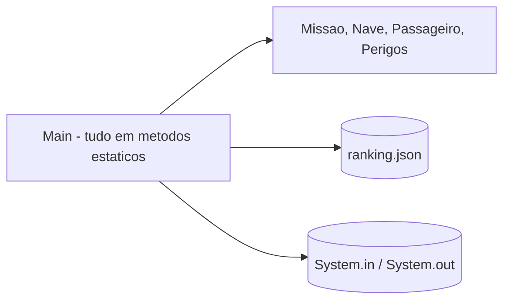
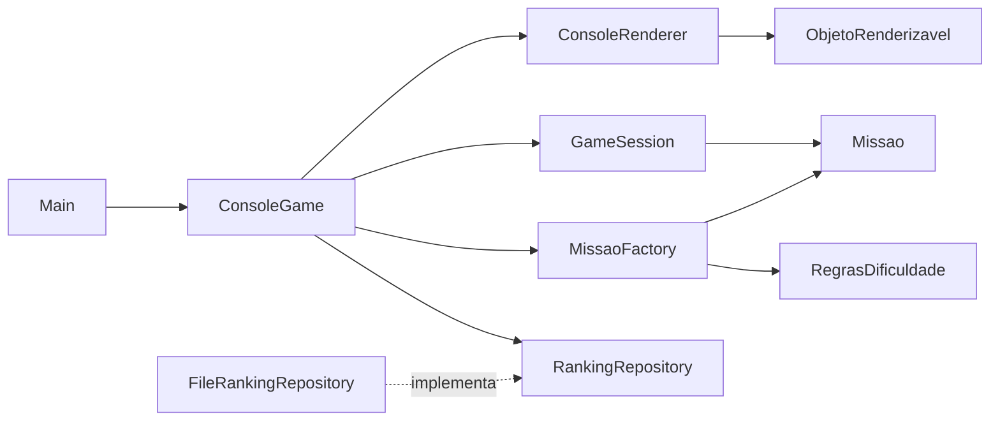
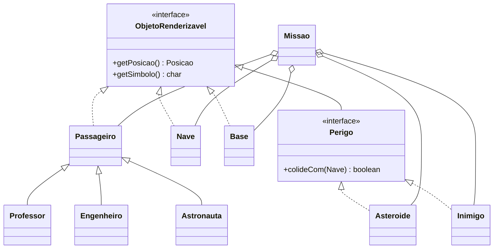

# Fase 01 - Tutorial de Refatoração Arquitetural

## 1. Introdução

Esta fase refatora o jogo console para separar regras de jogo da interface textual, preparando a migração futura para LibGDX.

## 2. Objetivos de aprendizagem

- Separar o jogo em camadas (`domain`, `application`, `console`, `infrastructure`).
- Reconhecer onde cada princípio SOLID foi aplicado e onde ainda há limitações.
- Reconhecer os padrões GRASP usados na distribuição de responsabilidades.
- Identificar os padrões de projeto presentes (Factory, Repository, Value Object, entre outros).
- Entender os ajustes de regra feitos durante a validação funcional.

## 3. Conceitos teóricos

### SOLID

| Sigla | Princípio | Ideia central |
|---|---|---|
| S | Single Responsibility | Uma classe deve ter um único motivo para mudar. |
| O | Open/Closed | Aberta para extensão, fechada para modificação. |
| L | Liskov Substitution | Subtipos devem poder substituir seus tipos base sem quebrar o uso. |
| I | Interface Segregation | Interfaces pequenas e específicas. |
| D | Dependency Inversion | Depender de abstrações, não de implementações concretas. |

### GRASP

- Information Expert: a responsabilidade fica com quem tem a informação.
- Creator: quem agrega ou usa os objetos cria os objetos.
- Controller: um objeto recebe e coordena eventos do sistema, sem conter a interface.
- Low Coupling e High Cohesion: poucas dependências e responsabilidades coesas.
- Polymorphism: comportamento variável resolvido por tipo, sem `if` por tipo.
- Pure Fabrication: classe artificial criada para manter coesão (não existe no domínio).
- Indirection e Protected Variations: um intermediário isola o ponto de variação.

### Padrões de projeto

- Factory, Repository, Value Object, Composição e Injeção de dependência manual.

## 4. Problemas encontrados no código original

O `Main.java` original (em `exercicio10/src`) tem mais de 500 linhas e concentra:

- Menu, leitura de entrada e loop de partida (`jogarPartida`, `lerLinha`).
- Regras de turno, colisão, pontuação e vitória.
- Geração do mapa e verificação de posição ocupada (`posicaoOcupada`).
- Regras de dificuldade em métodos estáticos (`definirPontuacaoInicial`).
- Desenho do mapa e legenda com símbolos escritos como texto fixo (`desenharMapa`).
- Persistência do ranking com leitura e escrita de JSON manual dentro do próprio `Main` (`loadRanking`, `saveRanking`, `parseRankingJson`) e classe interna `RankingEntry`.

Consequência: para trocar a interface (LibGDX) seria preciso reescrever também as regras.

## 5. Arquitetura antes da transformação



## 6. O que foi feito na migração

### 6.1 Passo a passo

1. Criar os pacotes `domain`, `application`, `console` e `infrastructure.ranking`.
2. Mover as regras de turno (movimento, embarque, base, colisão, pontuação, vitória) para `GameSession`.
3. Mover a criação do cenário para `MissaoFactory`, sem sobreposição de objetos.
4. Mover as regras de dificuldade para `Dificuldade`, `RegrasDificuldade` e `ConfiguracaoDificuldade`.
5. Converter a entrada textual em `Acao` (enum) para que a regra não dependa de teclas.
6. Mover o desenho do mapa para `ConsoleRenderer`, usando a interface `ObjetoRenderizavel`.
7. Extrair o ranking para `RankingRepository` (interface) e `FileRankingRepository` (arquivo JSON).
8. Reduzir `Main` à classe de composição: instancia as dependências e chama `ConsoleGame.run()`.
9. Criar `build.ps1` para compilar (e opcionalmente executar) com um comando.

### 6.2 Para onde foi cada responsabilidade

| Responsabilidade | Original (`Main`) | Fase 01 |
|---|---|---|
| Menu e loop de entrada | `main`, `lerLinha` | `ConsoleGame` |
| Regras de turno e vitória | `jogarPartida` | `GameSession` |
| Resultado de um turno | variáveis locais | `ResultadoTurno`, `EstadoPartida` |
| Comando do jogador | `String` comparada em `if` | `Acao.fromInput` |
| Criação do cenário | `posicaoOcupada` e geração inline | `MissaoFactory` |
| Parâmetros de dificuldade | `definirPontuacaoInicial` | `RegrasDificuldade`, `ConfiguracaoDificuldade` |
| Desenho do mapa e legenda | `desenharMapa` | `ConsoleRenderer` |
| Persistência do ranking | `loadRanking`, `saveRanking` | `RankingRepository`, `FileRankingRepository` |
| Composição | `main` | `Main` |

### 6.3 Ajustes de regra feitos durante a validação funcional

Os testes executados no console revelaram inconsistências que foram corrigidas:

- Passageiros e perigos podiam nascer na mesma célula (inclusive na base e na nave). `MissaoFactory` agora controla as posições ocupadas com um `Set`.
- A nave lotada impedia concluir a missão. Agora, ao chegar na base (`processarBase`), todos os passageiros desembarcam, liberando a capacidade, e a contagem de entregues sobe.
- A vitória exige todos os passageiros entregues na base (não apenas coletados).
- A capacidade da nave estava fixa em 3 enquanto a missão podia ter 4, 6 ou 8 passageiros. Agora é igual à quantidade de passageiros da dificuldade.
- O status do mapa tinha indicadores redundantes. Hoje mostra: `Vidas | Pontuacao | A bordo (atual/capacidade) | Entregues na base | Restantes no mapa`.
- A base virou a entidade `Base`, renderizável como os demais objetos, e a legenda deixou de ser texto fixo.

### 6.4 Diferenças em relação ao original

A refatoração não foi 100% neutra. Pontos que mudaram e devem ser decididos pela equipe:

- Símbolos do mapa: original usa `@`, `#`, `L`; esta fase usa `N`, `*`, `B`.
- Tamanho do mapa: original pergunta ao jogador; esta fase usa fixo de -5 a 5.
- Ranking: original mostra Top 5; esta fase mantém Top 10.
- Capacidade da nave: agora acompanha a dificuldade.

## 7. Código antes e depois

### Legenda e símbolos

Antes (`Main`): texto fixo, sem relação com as entidades.

```java
System.out.println("Legenda: @=Nave, P=Professor, E=Engenheiro, T=Astronauta, #=Asteroide, X=Inimigo, L=Plataforma de Pouso, .=Vazio");
```

Depois: cada entidade informa o próprio símbolo e o renderer apenas desenha.

```java
public interface ObjetoRenderizavel {
    Posicao getPosicao();
    char getSimbolo();
}

// ConsoleRenderer
private List<ObjetoRenderizavel> coletarObjetosRenderizaveis(Missao missao) {
    List<ObjetoRenderizavel> objetos = new ArrayList<>();
    objetos.add(missao.getBase());
    objetos.addAll(missao.getAsteroides());
    objetos.addAll(missao.getInimigos());
    objetos.addAll(missao.getPassageiros());
    objetos.add(missao.getNave());
    return objetos;
}
```

### Composição

Antes: `main` fazia tudo. Depois:

```java
ConsoleGame game = new ConsoleGame(
        new Scanner(System.in),
        new Random(),
        new ConsoleRenderer(),
        new MissaoFactory(),
        new FileRankingRepository(rankingPath)
);
game.run();
```

### Capacidade da nave

```java
// MissaoFactory
Nave nave = new Nave(0, 0, 3, cfg.getQuantidadePassageiros());
```

## 8. Onde foi usado SOLID

| Princípio | Onde | Como |
|---|---|---|
| SRP | `GameSession`, `ConsoleGame`, `ConsoleRenderer`, `MissaoFactory`, `FileRankingRepository` | Cada classe tem um motivo para mudar: regra de partida, fluxo de menu, desenho, criação de cenário, persistência. |
| OCP | `ObjetoRenderizavel`, `Perigo`, `Passageiro` | Um novo tipo de passageiro ou perigo que implemente a interface aparece no mapa sem mudar `desenharMapa`. Limite: `Dificuldade`, `RegrasDificuldade` e `MissaoFactory.criarPassageiroAleatorio` usam `switch`/`if` e precisam ser editados para novos casos. |
| LSP | `Professor`, `Engenheiro`, `Astronauta` estendem `Passageiro`; `Asteroide` e `Inimigo` implementam `Perigo` | `Missao`, `Nave` e `GameSession` tratam qualquer subtipo como `Passageiro` ou `Perigo` sem checar o tipo. |
| ISP | `ObjetoRenderizavel` (2 métodos), `RankingRepository` (2 métodos), `Perigo` | Interfaces pequenas; o renderer só conhece posição e símbolo. |
| DIP | `ConsoleGame` depende de `RankingRepository` | O fluxo do jogo não conhece o arquivo JSON; `FileRankingRepository` é injetado em `Main`. Limite: `ConsoleGame` ainda depende das classes concretas `ConsoleRenderer` e `MissaoFactory`. |

## 9. Onde foi usado GRASP

| Padrão GRASP | Onde | Como |
|---|---|---|
| Controller | `ConsoleGame` | Recebe a entrada do jogador, traduz para `Acao` e delega a `GameSession`. |
| Information Expert | `Posicao.mover`, `Nave.estaCheia`, `Nave.embarcar`, `Missao.houveColisaoComPerigo`, `Perigo.colideCom`, `Inimigo.moverAleatoriamente` | A regra fica com o objeto que possui os dados. |
| Creator | `MissaoFactory` | Cria `Nave`, `Passageiro`, `Asteroide` e `Inimigo` e os adiciona a `Missao`. `Missao` cria a `Base`. |
| Low Coupling | camadas `domain` e `application` | Não importam nada de `console` nem de `infrastructure`. |
| High Cohesion | classes pequenas por responsabilidade | `GameSession` só trata regras de turno; `ConsoleRenderer` só trata saída. |
| Polymorphism | `getSimbolo()`, `getPontuacao()` | Cada tipo informa a própria pontuação (Professor 20, Engenheiro 15, Astronauta 25, base 10) e o símbolo, sem `if` por tipo. |
| Pure Fabrication | `GameSession`, `ResultadoTurno`, `MissaoFactory`, `FileRankingRepository` | Classes que não existem no domínio, criadas para manter coesão. |
| Indirection / Protected Variations | `RankingRepository`, `ObjetoRenderizavel`, `Acao` | Isolam os pontos que mais tendem a mudar: persistência, forma de desenhar e forma de entrada. |

## 10. Padrões de projeto utilizados

| Padrão | Onde | Observação |
|---|---|---|
| Factory | `MissaoFactory` | Centraliza a montagem do cenário por dificuldade. |
| Repository | `RankingRepository` / `FileRankingRepository` | Esconde o formato e o local de armazenamento. |
| Value Object | `Posicao` | Imutável (`final`), com `equals` e `hashCode`; `mover` devolve nova instância. |
| Composição | `Nave`, `Passageiro`, `Base` e perigos possuem uma `Posicao` | Evita herdar só para ter x e y. |
| Herança com sobrescrita | `Passageiro` e seus subtipos | Subtipos sobrescrevem `getPontuacao()` e `getSimbolo()`. |
| Default method | `Perigo.colideCom` | Comportamento comum compartilhado por interface. |
| Enum com fábrica estática | `Acao.fromInput`, `Dificuldade.deString` | Traduz texto em valor tipado em um único lugar. |
| Injeção de dependência manual | `Main` | Monta o grafo de objetos e passa pelo construtor. |
| Objeto de configuração | `ConfiguracaoDificuldade` + `RegrasDificuldade.obter` | Tabela de parâmetros por dificuldade. |

Observação: a versão anterior deste tutorial citava Strategy para a dificuldade. No código atual a dificuldade é uma tabela de configuração (`switch` + objeto de valores), não uma família de estratégias intercambiáveis. Virar Strategy é um exercício proposto abaixo.

## 11. Arquitetura resultante

### Camadas e dependencias



### Domínio



## 12. Limitações conhecidas e próximos passos

- `ConsoleGame.processarVitoria` ainda contém a regra de entrada no ranking (Top 10, ordenação). Essa regra pertence a `application` e deveria sair do console (SRP).
- `ConsoleGame` depende de `ConsoleRenderer` e `MissaoFactory` concretos; extrair interfaces completaria o DIP.
- A legenda do `ConsoleRenderer` obtém os símbolos instanciando objetos de exemplo. Um catálogo de símbolos no domínio evitaria isso.
- `Dificuldade`/`RegrasDificuldade`/`criarPassageiroAleatorio` usam `switch`/`if`; novos tipos exigem editar essas classes (OCP parcial).
- `GameSession` ainda recebe `Random` e `min/max` diretamente; um objeto de configuração do mapa simplificaria o construtor.
- Não há testes automatizados; a validação foi feita por execução simulada via console.
- `GameSession.verificarPontuacao` roda antes de `verificarVitoria`: se a pontuação chegar a zero no mesmo turno da última entrega, a partida termina em derrota.
- `FileRankingRepository` ignora `IOException` em silêncio e `Passageiro.setPosicao` não é usado.

As classes do código-fonte têm Javadoc indicando onde SOLID, GRASP e padrões foram aplicados (e os limites de cada um).

## 13. Como executar e testar

Na pasta `fase-01-refatoracao`:

```powershell
.\build.ps1          # compila para a pasta out
.\build.ps1 -Run     # compila e executa
```

Roteiro de validação manual:

1. Menu: opções 1 a 4 e opção inválida.
2. Partida fácil: conferir que `A bordo`, `Entregues na base` e `Restantes no mapa` fecham com o total de passageiros.
3. Embarcar (`E`) em uma célula com passageiro e sem passageiro.
4. Levar passageiros à base e verificar o desembarque e a vitória.
5. Colidir com asteroide ou inimigo e conferir perda de vida e de pontos.
6. Conferir o ranking após uma vitória.
7. Repetir em `medio` e `dificil` e verificar que a capacidade acompanha a quantidade de passageiros.

## 14. Exercícios para os alunos

1. Adicionar um novo tipo de passageiro sem alterar o renderer.
2. Criar uma nova dificuldade e identificar quantas classes precisaram ser alteradas (e por quê).
3. Transformar `RegrasDificuldade` em Strategy real, com uma implementação por dificuldade.
4. Mover a regra de entrada no ranking de `ConsoleGame` para a camada `application`.
5. Criar `RankingRepository` em memória para testes.
6. Extrair interfaces para `ConsoleRenderer` e `MissaoFactory` e injetar por construtor.

## 15. Conclusão

A fase separa regra de jogo, interface e persistência, reduzindo acoplamento e preparando a troca da interface por LibGDX sem reescrever o domínio. SOLID e GRASP foram aplicados de forma parcial e as limitações restantes estão listadas na seção 12 para as próximas fases.
