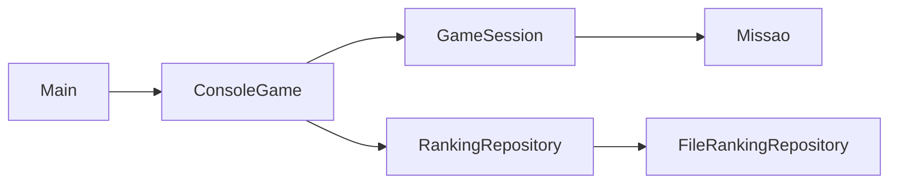

# Fase 01 - Tutorial de Refatoracao Arquitetural

## 1. Introducao

Esta fase refatora o jogo console para separar regras de jogo da interface textual, preparando a migracao futura para LibGDX.

## 2. Objetivos de aprendizagem

- Aplicar SRP e baixo acoplamento.
- Aplicar GRASP Controller, Creator e Information Expert.
- Introduzir Strategy para configuracao de dificuldade.
- Isolar persistencia via interface de repositorio.

## 3. Conceitos teoricos

- SOLID (foco em SRP e DIP)
- GRASP (Controller, Creator, Expert)
- Strategy

## 4. Problemas encontrados no codigo original

- `Main` acumulava fluxo, regras, renderizacao e persistencia.
- Dificuldade com regras dispersas em condicionais.
- Ranking acoplado ao fluxo principal.

## 5. Arquitetura antes da transformacao

Toda a aplicacao concentrada em `Main` com apoio de entidades de dominio.

## 6. Passo a passo da implementacao

1. Criar pacotes `domain`, `application`, `console` e `infrastructure`.
2. Mover regras de turno para `GameSession`.
3. Mover criacao de cenario para `MissaoFactory`.
4. Extrair persistencia para `RankingRepository`.
5. Manter `Main` apenas para composicao.

## 7. Codigo antes e depois

Comparar `Main` original da raiz com `Main` desta fase.

## 8. Explicacao das alteracoes

A camada `console` apenas converte entrada em `Acao` e exibe o estado da sessao.

## 9. Arquitetura resultante

## 10. Como executar e testar

1. Compilar com `javac`.
2. Executar `br.edu.unifor.missaomarte.Main`.
3. Validar menu, partida, colisao, vitoria e ranking.

## 11. Exercicios para os alunos

1. Adicionar novo tipo de passageiro sem alterar renderer.
2. Criar nova configuracao de dificuldade.
3. Substituir ranking em arquivo por memoria para testes.

## 12. Conclusao

A fase reduz acoplamento e prepara a troca da interface sem perda das regras de negocio.
