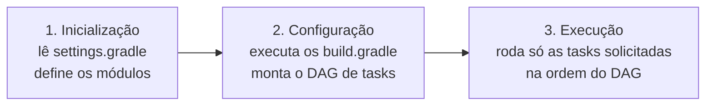
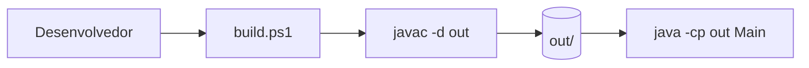
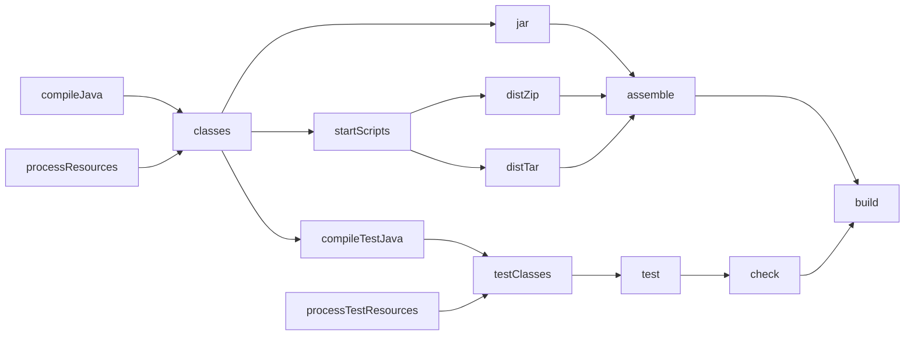
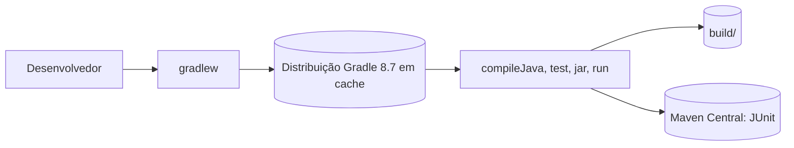

# Fase 02 - Tutorial de Migração para Gradle

## 1. Introdução

Na Fase 1 o jogo foi separado em camadas, mas continuou sendo compilado "na mão" com `javac` (script `build.ps1`). Nesta fase o mesmo projeto passa a ser construído pelo **Gradle**: compilação, testes, execução e empacotamento viram tarefas padronizadas e reproduzíveis em qualquer máquina.

O código do jogo **não muda**. Mudam a organização das pastas e a forma de construir o projeto.

## 2. Objetivos de aprendizagem

- Explicar o que é um build tool e por que usar Gradle.
- Ler e escrever `settings.gradle` e `build.gradle`.
- Usar o plugin `application` e a tarefa `run`.
- Declarar dependências com os escopos `testImplementation` e `testRuntimeOnly`.
- Entender o grafo de tarefas (DAG) de um `build`.
- Explicar a diferença entre o Gradle **instalado** e o **Gradle Wrapper**.
- Executar testes automatizados com JUnit 5.

## 3. Conceitos teóricos

Esta seção reúne o referencial teórico da fase. O conteúdo é adaptado das Partes 1 e 2 do [tutorial de referência](../../../../tutorial-api-gradle-libgdx.md) (arquivo `tutorial-api-gradle-libgdx.md`), e cada subseção indica a seção de origem. Os trechos "No projeto" ligam a teoria ao que foi feito nesta fase.

### 3.1 O que é uma API

*(Referencial: "Parte 1 - O que é uma API?")*

**API** (*Application Programming Interface*) é um conjunto de classes, interfaces e métodos que outra pessoa já escreveu e que você usa sem precisar conhecer a implementação interna. Pense no painel de um carro: você usa volante, acelerador e freio sem entender o motor.

| API | O que oferece |
|---|---|
| `java.util.ArrayList` | Lista dinâmica de objetos |
| `java.util.Scanner` | Leitura de dados do console |
| `java.io.File` | Acesso ao sistema de arquivos |
| `javax.swing.*` | Interface gráfica desktop |
| libGDX | Engine de jogos 2D/3D |
| Spring Boot | Backend REST em Java |

Sem APIs, cada desenvolvedor teria de escrever do zero como abrir uma janela, ler o teclado, desenhar na tela ou detectar colisões. Com a API certa, uma chamada como `batch.draw(texturaNave, x, y)` basta.

```text
┌───────────────────────────────┐
│          SEU CÓDIGO           │  <- você escreve aqui
└──────────────┬────────────────┘
               │ usa
┌──────────────▼────────────────┐
│       API (biblioteca)        │  <- você apenas usa
└──────────────┬────────────────┘
               │ usa
┌──────────────▼────────────────┐
│ Implementação / Sist. Oper.   │  <- detalhe interno
└───────────────────────────────┘
```

Seu código **depende** da API, e a API depende da camada abaixo. Você só enxerga a interface exposta.

**No projeto:** o jogo já usa APIs da biblioteca padrão (`Scanner`, `Random`, `java.nio.file.Files`). Nesta fase ele passa a depender também de uma API externa, a do **JUnit 5**, para escrever testes. Quem baixa e disponibiliza essa biblioteca é o Gradle. Na Fase 3 a API será a do libGDX.

### 3.2 Origem e versões do Gradle

*(Referencial: "História e Origem do Gradle" e "Versões do Gradle")*

O Gradle foi criado por **Hans Dockter** e **Adam Murdoch**, insatisfeitos com a rigidez do Maven (configuração em XML e pouca lógica condicional). A ideia foi combinar o modelo de dependências do Maven, a flexibilidade de scripts do Ant e uma DSL expressiva baseada em Groovy. É open source, sob licença Apache 2.0 (`github.com/gradle/gradle`).

```text
2007  Início do desenvolvimento
2008  Primeira versão pública
2011  Fundação da Gradle Inc.
2012  Gradle 1.0 (primeira versão estável)
2013  Google adota o Gradle como build system do Android
2018  Gradle 5.0: Kotlin DSL estável
2023  Gradle 8.0: Configuration Cache estável
2024  Gradle 8.7
```

O Gradle usa versionamento semântico (major.minor.patch). A adoção pelo Android foi decisiva para torná-lo dominante no ecossistema Java/Kotlin, inclusive para a libGDX, que usa a mesma pilha.

Para este projeto usamos o **Gradle 8.7**, que, segundo o referencial, é compatível com Java 17 e 21, libGDX 1.12.1 e Android Gradle Plugin 8.x. Regra prática do referencial: em projetos novos use uma versão LTS recente e evite versões muito antigas, que podem ser incompatíveis com plugins modernos.

**No projeto:** a máquina tem o Gradle 9.8.2 instalado, mas o projeto fixa a 8.7 por meio do wrapper (seção 3.9).

### 3.3 O que é um build tool

*(Referencial: "O que é um Build Tool?")*

Para compilar e executar um projeto Java é preciso: baixar bibliotecas externas, colocar os `.jar` no classpath, compilar os `.java` na ordem certa, empacotar o resultado e executar. Fazer isso manualmente em projetos com dezenas de dependências é inviável. O **build tool** automatiza tudo com um único comando.

```text
Você digita:  gradlew run
                  ↓
Gradle faz:   [1] resolve e baixa dependências
              [2] compila os fontes
              [3] executa o programa
```

**No projeto:** na Fase 1 esse papel era do `build.ps1` (lista os arquivos e chama `javac`). O script não baixava dependências, não rodava testes e só funcionava no PowerShell.

### 3.4 Gradle vs Maven

*(Referencial: "Gradle vs Maven")*

| Característica | Maven | Gradle |
|---|---|---|
| Configuração | XML (`pom.xml`), verboso | Groovy ou Kotlin DSL, conciso |
| Flexibilidade | Baixa (estrutura rígida) | Alta (lógica condicional, scripts) |
| Desempenho | Mais lento | Mais rápido (cache incremental) |
| Android | Não | Padrão oficial |
| Jogos | Raro | Padrão (libGDX) |
| Cache de build | Não | Sim (Build Cache) |
| Multi-módulo | Sim | Sim (mais flexível) |

A mesma dependência nas duas ferramentas:

```xml
<!-- Maven (pom.xml) -->
<dependency>
    <groupId>org.junit.jupiter</groupId>
    <artifactId>junit-jupiter</artifactId>
    <version>5.10.2</version>
    <scope>test</scope>
</dependency>
```

```groovy
// Gradle (build.gradle)
testImplementation 'org.junit.jupiter:junit-jupiter:5.10.2'
```

A libGDX e o Android usam Gradle, por isso a disciplina adota essa ferramenta.

### 3.5 Conceitos fundamentais do Gradle

*(Referencial: "Conceitos Fundamentais do Gradle")*

**Tasks (tarefas).** Tudo que o Gradle faz é uma task: `compileJava` (compila), `processResources` (copia recursos), `jar` (empacota), `run` (executa), `test` (roda testes), `clean` (apaga `build/`). Cada task tem **entradas** (fontes, configurações), **saídas** (classes, JARs) e pode **depender** de outras. Também é possível criar tasks próprias:

```groovy
tasks.register('ola') {
    doLast {
        println 'Olá, Missão Marte!'
    }
}
```

**DAG (grafo acíclico dirigido).** O Gradle organiza as tasks em um grafo em que cada task pode depender de outras, a ordem de execução é calculada automaticamente e não existem ciclos. Ao pedir uma task, o Gradle executa apenas as necessárias para atingi-la.

**Gradle Daemon.** Processo que permanece em segundo plano após o primeiro build. O primeiro build é lento (inicia a JVM, carrega plugins); os seguintes são mais rápidos porque o daemon já está em memória. O comando `gradlew --status` mostra os daemons.

**Build Cache e `UP-TO-DATE`.** O Gradle guarda os resultados das tasks. Se as entradas de uma task não mudaram, ele reutiliza o resultado e marca a task como `UP-TO-DATE`, sem recompilar.

```text
> Task :compileJava UP-TO-DATE      <- nada mudou
> Task :compileJava                 <- algo mudou, recompilou
```

**Configuration Cache.** Desde o Gradle 8.0 existe um cache que guarda o resultado da própria leitura dos arquivos `.gradle`, acelerando ainda mais as execuções seguintes.

**No projeto:** o `gradlew build` a partir de um estado limpo executou 7 tasks (`compileJava`, `jar`, `startScripts`, `distTar`, `distZip`, `compileTestJava` e `test`) e as demais ficaram sem fonte ou apenas agruparam tasks. O grafo completo está na seção 8.

### 3.6 DSL: Groovy ou Kotlin

*(Referencial: "DSL: Groovy vs Kotlin")*

O arquivo de build pode ser escrito em duas linguagens:

| | Groovy DSL | Kotlin DSL |
|---|---|---|
| Arquivo | `build.gradle` | `build.gradle.kts` |
| Linguagem | Groovy (dinâmica) | Kotlin (estática) |
| Autocompletar no VS Code | Parcial | Completo |
| Velocidade de parse | Mais rápida | Um pouco mais lenta |
| Erros em tempo de edição | Não | Sim |
| Popularidade | Padrão histórico | Crescente |

```groovy
// Groovy DSL (build.gradle)
dependencies {
    testImplementation 'org.junit.jupiter:junit-jupiter:5.10.2'
}
```

```kotlin
// Kotlin DSL (build.gradle.kts)
dependencies {
    testImplementation("org.junit.jupiter:junit-jupiter:5.10.2")
}
```

A diferença mais visível é o uso de aspas duplas e de parênteses obrigatórios na DSL Kotlin. O referencial adota a **Groovy DSL** por ser mais simples para iniciantes e mais comum nos exemplos da libGDX; esta fase também.

### 3.7 Estrutura de um `build.gradle`

*(Referencial: "Estrutura de um `build.gradle`")*

Todo projeto Gradle tem ao menos um `build.gradle`, com blocos como estes:

```groovy
// 1. PLUGINS: adicionam tarefas e funcionalidades
plugins {
    id 'java'          // compileJava, jar, test...
    id 'application'   // run, installDist...
}

// 2. IDENTIDADE DO PROJETO
group   = 'br.edu.unifor'
version = '1.0'

// 3. REPOSITÓRIOS: onde buscar dependências
repositories {
    mavenCentral()
}

// 4. DEPENDÊNCIAS
dependencies { /* ... */ }

// 5. CONFIGURAÇÃO DO PLUGIN
application {
    mainClass = 'br.edu.unifor.missaomarte.Main'
}

// 6. CONFIGURAÇÃO DO COMPILADOR
java {
    sourceCompatibility = JavaVersion.VERSION_17
    targetCompatibility = JavaVersion.VERSION_17
}
```

**`group` e `version`.** No ecossistema Java todo artefato tem três coordenadas, o **GAV**: `grupo:artefato:versão`. Exemplo real: `org.junit.jupiter:junit-jupiter:5.10.2`. Neste projeto o GAV é `br.edu.unifor:missao-marte:1.0`, onde `missao-marte` vem de `rootProject.name`.

**Convenção sobre configuração.** O plugin `java` espera os fontes em `src/main/java` e os testes em `src/test/java`; seguindo essa estrutura não é preciso configurar nada.

### 3.8 Dependências e escopos

*(Referencial: "Dependências e seus Escopos")*

Ao declarar uma dependência você escolhe um **escopo**, que define onde ela será usada:

| Escopo | Usado em | Exportado para quem depende? | Exemplo de uso |
|---|---|---|---|
| `implementation` | compilação e execução | Não | Dependências internas |
| `api` | compilação e execução | Sim | Dependências expostas na API pública |
| `runtimeOnly` | apenas execução | Não | Drivers JDBC, bibliotecas nativas |
| `testImplementation` | apenas testes | Não | JUnit, Mockito |
| `compileOnly` | apenas compilação | Não | Anotações, Lombok |

**Como o Gradle baixa as dependências:**

```text
build.gradle declara:   testImplementation 'org.junit.jupiter:junit-jupiter:5.10.2'
        ↓
Gradle consulta o repositório (Maven Central)
        ↓
Baixa o .jar (biblioteca) e o .pom (metadados e dependências transitivas)
        ↓
Guarda em cache local: ~/.gradle/caches/modules-2/files-2.1/...
        ↓
Adiciona ao classpath
```

Por causa do cache em `~/.gradle/caches/`, o segundo build é muito mais rápido: nada precisa ser baixado de novo.

**No projeto:** o código de produção só usa a biblioteca padrão, então não há `implementation`. Há duas dependências de teste: `testImplementation` (API do JUnit 5) e `testRuntimeOnly` (o *launcher* da plataforma JUnit, necessário apenas na execução dos testes).

### 3.9 O Gradle Wrapper

*(Referencial: "O Gradle Wrapper em Detalhes")*

**Problema.** O aluno A tem o Gradle 7.6, o aluno B tem o 8.7 e o projeto foi criado com o 8.7. Os builds diferem e podem falhar.

**Solução.** O Wrapper é um script incluído no próprio projeto que lê a versão exigida em `gradle-wrapper.properties`, verifica se ela está em `~/.gradle/wrapper/dists/`, baixa se não estiver e executa o Gradle exatamente nessa versão.

```text
fase-02-gradle/
├── gradlew.bat                    <- script do wrapper (Windows)
├── gradlew                        <- script do wrapper (Linux/macOS)
└── gradle/wrapper/
    ├── gradle-wrapper.jar         <- mini-programa que baixa o Gradle
    └── gradle-wrapper.properties  <- versão e URL de download
```

```properties
distributionBase=GRADLE_USER_HOME
distributionPath=wrapper/dists
distributionUrl=https\://services.gradle.org/distributions/gradle-8.7-bin.zip
zipStoreBase=GRADLE_USER_HOME
zipStorePath=wrapper/dists
```

A linha `distributionUrl` define qual versão será usada: quem clonar o projeto e rodar `gradlew` usará sempre a mesma.

**Regra de ouro do referencial:** não use `gradle <task>` (instalação global); use sempre `gradlew <task>`.

**No projeto:** a única vez em que o `gradle` global foi usado foi para **gerar** o wrapper (`gradle wrapper --gradle-version 8.7`). Depois disso, todos os comandos usam `gradlew`. A seção 8 detalha a diferença entre o Gradle instalado (9.8.2) e o do wrapper (8.7).

### 3.10 Ciclo de vida de um build

*(Referencial: "Ciclo de Vida de um Build Gradle")*

Todo build passa por três fases:



- **Inicialização:** o Gradle lê o `settings.gradle` para saber quais módulos existem.
- **Configuração:** lê e executa os `build.gradle`, registra plugins, dependências e tasks e constrói o DAG. Nenhuma compilação acontece nesta fase.
- **Execução:** executa as tasks na ordem do DAG.

**No projeto:** o `settings.gradle` declara apenas `rootProject.name = 'missao-marte'`, ou seja, um único módulo.

### 3.11 Projeto multi-módulo (prévia da Fase 3)

*(Referencial: "Projeto Multi-módulo (libGDX)")*

A libGDX organiza o projeto em módulos porque o mesmo jogo pode rodar em desktop, Android e web:

```text
missao-marte/
├── settings.gradle     <- lista os módulos
├── build.gradle        <- configuração raiz (versões compartilhadas)
├── core/               <- lógica do jogo, independente de plataforma
├── lwjgl3/             <- launcher desktop
└── android/            <- launcher Android (futuro)
```

O módulo `core` concentra a lógica e não conhece nenhuma plataforma; os demais apenas iniciam a plataforma e delegam ao `core`.

```groovy
// settings.gradle
rootProject.name = 'missao-marte'
include 'core'
include 'lwjgl3'

// lwjgl3/build.gradle
dependencies {
    implementation project(':core')   // lwjgl3 depende de core
}
```

**No projeto:** esta fase continua com um único módulo. A separação em camadas feita na Fase 1 (`domain` e `application` sem dependência de `console`) é o que tornará possível, na Fase 3, mover a lógica para um módulo `core`.

### 3.12 Comandos essenciais

*(Referencial: "Comandos Gradle Essenciais")*

Execute na pasta raiz do projeto:

```bat
.\gradlew.bat build                  :: compila e testa tudo
.\gradlew.bat run --console=plain    :: executa o jogo
.\gradlew.bat test                   :: executa os testes
.\gradlew.bat clean                  :: remove a pasta build/
.\gradlew.bat tasks                  :: lista as tasks disponíveis
.\gradlew.bat tasks --all            :: inclui as tasks internas
.\gradlew.bat dependencies           :: árvore de dependências
.\gradlew.bat --version              :: versão do Gradle e do JVM em uso
.\gradlew.bat build --profile        :: tempo de cada task
.\gradlew.bat run --info             :: log mais detalhado
.\gradlew.bat build --dry-run        :: mostra as tasks sem executar
.\gradlew.bat --status               :: daemons em execução
```

Em projetos multi-módulo o comando indica o módulo, por exemplo `gradlew lwjgl3:run` (Fase 3). Aqui, com um único módulo, basta `gradlew run`.

Saída típica (abreviada) de um build bem-sucedido:

```text
> Task :compileJava
> Task :classes
> Task :jar
> Task :test

BUILD SUCCESSFUL in 4s
8 actionable tasks: 7 executed, 1 up-to-date
```

`executed` indica que a task rodou (algo mudou); `up-to-date` indica que foi reaproveitada (o cache funcionou).

## 4. Problemas encontrados no código original (Fase 1)

- Build por script próprio (`build.ps1`) que monta a lista de arquivos e chama `javac`, sem suporte a dependências, testes ou empacotamento.
- Comando restrito ao PowerShell/Windows.
- Nenhum teste automatizado: a validação era manual, por execução simulada.
- A estrutura `src/br/...` não segue a convenção esperada pelas ferramentas Java (IDEs, CI, Gradle, Maven).

## 5. Arquitetura antes da transformação



Estrutura de pastas:

```text
fase-01-refatoracao/
├── build.ps1
├── out/                  # gerado
└── src/br/edu/unifor/missaomarte/...
```

## 6. Passo a passo da implementação

1. Criar a pasta `fase-02-gradle` e copiar os fontes de `fase-01-refatoracao/src` para `src/main/java`.

   ```powershell
   Copy-Item ..\fase-01-refatoracao\src\* src\main\java -Recurse
   ```

2. Criar `settings.gradle` com o nome do projeto.
3. Criar `build.gradle` com plugin, repositório, versão do Java, classe principal e dependências de teste.
4. Gerar o Wrapper com o Gradle instalado, apontando para a versão 8.7:

   ```powershell
   gradle wrapper --gradle-version 8.7
   .\gradlew.bat wrapper --gradle-version 8.7   # alinha jar e scripts à 8.7
   ```

5. Conferir a versão e o JVM usados:

   ```powershell
   .\gradlew.bat --version
   ```

6. Escrever os testes JUnit 5 em `src/test/java` (seção 8).
7. Compilar, testar e executar:

   ```powershell
   .\gradlew.bat clean build
   .\gradlew.bat run --console=plain
   ```

8. Criar `.gitignore` com `build/`, `.gradle/` e `ranking.json`.

## 7. Código antes e depois

### Build

Antes (`build.ps1`, resumo):

```powershell
$javaFiles = Get-ChildItem -Recurse src -Filter '*.java' | ForEach-Object { $_.FullName }
javac -encoding UTF-8 -d out $javaFiles
java -cp out br.edu.unifor.missaomarte.Main
```

Depois (`build.gradle`):

```groovy
plugins {
    id 'application'
}

group = 'br.edu.unifor'
version = '1.0'

repositories {
    mavenCentral()
}

java {
    sourceCompatibility = JavaVersion.VERSION_17
    targetCompatibility = JavaVersion.VERSION_17
}

tasks.withType(JavaCompile).configureEach {
    options.encoding = 'UTF-8'
}

application {
    mainClass = 'br.edu.unifor.missaomarte.Main'
}

run {
    standardInput = System.in
}

dependencies {
    testImplementation 'org.junit.jupiter:junit-jupiter:5.10.2'
    testRuntimeOnly 'org.junit.platform:junit-platform-launcher'
}

test {
    useJUnitPlatform()
}
```

`settings.gradle`:

```groovy
rootProject.name = 'missao-marte'
```

### Estrutura

| Antes | Depois |
|---|---|
| `src/br/edu/unifor/missaomarte/...` | `src/main/java/br/edu/unifor/missaomarte/...` |
| (sem testes) | `src/test/java/br/edu/unifor/missaomarte/...` |
| `out/` | `build/` |
| `build.ps1` | `gradlew` e `gradlew.bat` |

## 8. Explicação das alterações

### `settings.gradle`
Define o nome do projeto e quais módulos existem. Aqui há um único módulo. Na Fase 3 ele passará a listar `core` e `lwjgl3`.

### `plugins { id 'application' }`
Aplica o plugin `java` (tarefas `compileJava`, `test`, `jar`...) e adiciona `run`, `distZip` e `installDist`.

### `repositories { mavenCentral() }`
Onde o Gradle procura as dependências. O jogo não tem dependências de execução; o repositório é usado pelas bibliotecas de teste.

### `java { sourceCompatibility ... }`
Fixa o nível da linguagem em Java 17. O JDK que executa o Gradle é escolhido por `JAVA_HOME`, e não por este bloco.

### `options.encoding = 'UTF-8'`
Evita que os acentos dos fontes dependam da configuração do sistema.

### `application { mainClass = ... }`
Diz ao plugin qual classe tem o `main`. É usada por `run` e pelos scripts gerados em `installDist`/`distZip`.

### `run { standardInput = System.in }`
O jogo lê o teclado com `Scanner(System.in)`. Por padrão o `run` do Gradle não repassa a entrada ao programa; sem esta linha o jogo recebe fim de entrada imediatamente.

### Dependências e escopos

| Declaração | Escopo | Motivo |
|---|---|---|
| `testImplementation 'org.junit.jupiter:junit-jupiter:5.10.2'` | Compilação e execução dos testes | API do JUnit 5 para escrever os testes |
| `testRuntimeOnly 'org.junit.platform:junit-platform-launcher'` | Somente execução dos testes | Exigido pelo Gradle 9; no 8.7 é opcional |

Nada é declarado com `implementation` porque o código de produção só usa a biblioteca padrão.

### Gradle instalado x Gradle Wrapper

Nesta máquina há duas versões envolvidas:

| | Gradle instalado | Wrapper |
|---|---|---|
| Versão | 9.8.2 | 8.7 |
| Comando | `gradle` | `gradlew` / `gradlew.bat` |
| Onde fica | `C:\java\gradle-9.8.2` | baixado para `~/.gradle/wrapper/dists` |
| Quem decide a versão | quem instalou | `gradle/wrapper/gradle-wrapper.properties` do projeto |

O wrapper garante que todo aluno use a mesma versão do Gradle, sem instalar nada. O Gradle instalado serviu apenas para gerar o wrapper. O comando `gradle wrapper --gradle-version 8.7` escreve os arquivos, e a distribuição 8.7 só é baixada na primeira vez que `gradlew` é executado.

Executar `gradlew wrapper` no Windows imprimiu `exitWithErrorLevel` e terminou com código 1, provavelmente porque o `gradlew.bat` é reescrito durante a própria execução. O wrapper foi gerado corretamente (o build da tarefa `wrapper` foi bem-sucedido) e `gradlew --version` funciona normalmente.

### Compatibilidade de versões

- O Gradle 8.7 não é compatível com o JDK 25. Se `JAVA_HOME` apontar para ele, o build falha. Esta máquina tem JDKs 8, 15, 17, 21 e 25 em `C:\Program Files\Java`; confira sempre com `gradlew --version`.
- O mesmo projeto foi compilado e testado com o wrapper 8.7 e com o Gradle 9.8.2 instalado, ambos com sucesso.

### Grafo de tarefas de `gradlew build`



`processResources` e `processTestResources` aparecem como `NO-SOURCE`, pois o projeto não tem recursos.

### Testes unitários

Foram escritos 28 testes JUnit 5, que descrevem o comportamento atual (não o alteram):

| Classe de teste | Testes | O que verifica |
|---|---|---|
| `PosicaoTest` | 4 | Limites do mapa, igualdade por valor, imutabilidade |
| `NaveTest` | 5 | Capacidade, embarque e desembarque, vidas, pontuação e símbolo por tipo de passageiro |
| `AcaoTest` | 3 | Tradução de comandos e entradas inválidas |
| `MissaoFactoryTest` | 5 | Quantidades por dificuldade, capacidade igual ao total de passageiros, nave na base, sem elementos sobrepostos (50 sementes x 3 dificuldades) |
| `GameSessionTest` | 7 | Coleta e entrega na base com vitória, nave lotada, colisão, derrota por pontuação, abortar, comando inválido |
| `FileRankingRepositoryTest` | 4 | Gravar e ler, caracteres especiais no nome, limpar, arquivo inexistente ou inválido |

O teste do ranking usa `@TempDir`, então não escreve `ranking.json` no projeto. O teste de `GameSession` monta a `Missao` manualmente: isso só é possível porque a Fase 1 separou as regras da interface.

## 9. Arquitetura resultante



```text
fase-02-gradle/
├── settings.gradle
├── build.gradle
├── gradlew, gradlew.bat
├── gradle/wrapper/{gradle-wrapper.jar, gradle-wrapper.properties}
├── .gitignore
├── README.md
├── docs/
└── src/
    ├── main/java/br/edu/unifor/missaomarte/{domain, application, console, infrastructure}
    └── test/java/br/edu/unifor/missaomarte/{domain, application, infrastructure}
```

A arquitetura em camadas da Fase 1 permanece intacta. Os 26 arquivos `.java` copiados são idênticos aos da Fase 1 (comparação por hash).

## 10. Como executar e testar

```powershell
cd exercicio10\fases\fase-02-gradle
.\gradlew.bat --version
.\gradlew.bat clean build
.\gradlew.bat test
.\gradlew.bat run --console=plain
```

Roteiro de validação executado:

| Verificação | Resultado |
|---|---|
| `gradlew --version` | Gradle 8.7, JVM 17.0.10 |
| `gradlew clean build` | Sucesso |
| Testes | 28 executados, 0 falhas, 0 erros |
| `gradlew run` nas dificuldades fácil, médio e difícil | Menu, legenda e linha de status idênticos aos da Fase 1 (`A bordo: 0/4`, `0/6`, `0/8`), saída 0 |
| Sair pelo menu | Saída 0 |
| `ranking.json` | Gravado em `fase-02-gradle`; o da Fase 1 não foi alterado |
| Fontes de `src/main/java` x Fase 1 | 26 arquivos idênticos |
| `fase-01-refatoracao` e `exercicio10/src` | Nenhum arquivo alterado |
| Build com o Gradle 9.8.2 instalado | Sucesso |
| Build limpo (sem `build/` e `.gradle/`) pelo wrapper | Sucesso, 28 testes |

Limitação da validação: o mapa é sorteado a cada partida, então a vitória completa pelo console não é reproduzível. Ela é coberta pelo teste `GameSessionTest`.

### Problemas comuns

| Sintoma | Causa | Solução |
|---|---|---|
| Jogo encerra logo ao iniciar com `gradlew run` | Entrada padrão não repassada | Manter `run { standardInput = System.in }` |
| Build falha com erro de versão do Java | `JAVA_HOME` aponta para JDK não suportado pelo Gradle 8.7 | Apontar `JAVA_HOME` para o JDK 17 |
| `java -version` mostra outro JDK | PATH com outro JDK antes do JDK 17 | Colocar `...\Java\jdk-17\bin` no início do PATH e abrir um terminal novo |
| Saída cheia de barras de progresso | Console rico do Gradle | Usar `--console=plain` |

## 11. Exercícios para os alunos

1. Rode `gradlew tasks` e `gradlew tasks --all`. Quais tarefas foram adicionadas pelo plugin `application`?
2. Rode `gradlew build --dry-run` e desenhe o grafo de tarefas. Compare com o diagrama da seção 8.
3. Rode `gradlew installDist` e execute o script gerado em `build/install/missao-marte/bin`. Qual é a diferença para `gradlew run`?
4. Remova a linha `standardInput = System.in`, rode `gradlew run` e explique o que acontece.
5. Mude `gradle-wrapper.properties` para outra versão do Gradle e rode `gradlew --version`. O que muda e o que não muda?
6. Adicione um teste para `ConsoleRenderer` (dica: ele imprime em `System.out`; o que seria preciso para testá-lo?).
7. Quebre de propósito uma regra (por exemplo, a capacidade da nave) e veja qual teste falha.
8. Troque o `build.gradle` para a DSL Kotlin (`build.gradle.kts`) seguindo o referencial.

## 12. Conclusão

O jogo agora é construído, testado e executado por um único conjunto de comandos (`gradlew`) que funciona do mesmo modo em qualquer máquina com JDK 17. A Fase 1 tornou possível testar as regras sem o console; a Fase 2 aproveitou isso para introduzir testes automatizados e dependências. O projeto está pronto para receber, na Fase 3, o libGDX como dependência e a divisão em módulos.

Pendências herdadas da Fase 1, intencionalmente não tratadas aqui: a regra de entrada no ranking continua em `ConsoleGame` e a classe `ConsoleRenderer` ainda não tem testes.
