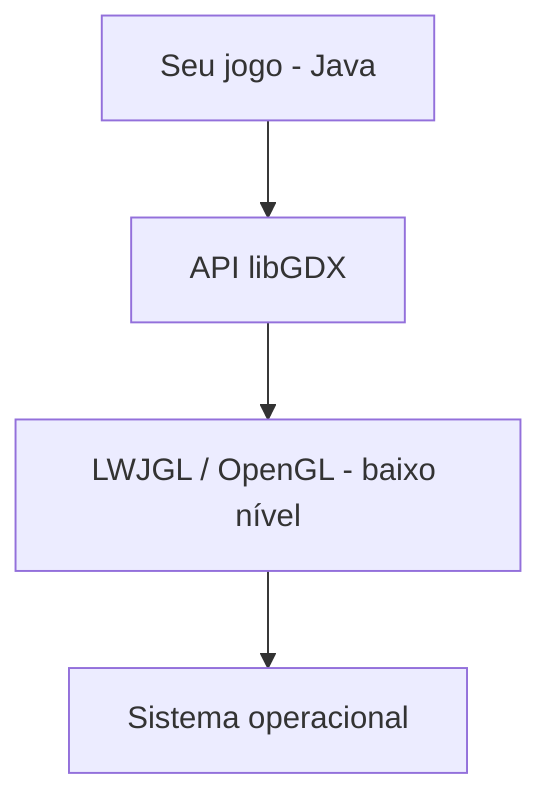
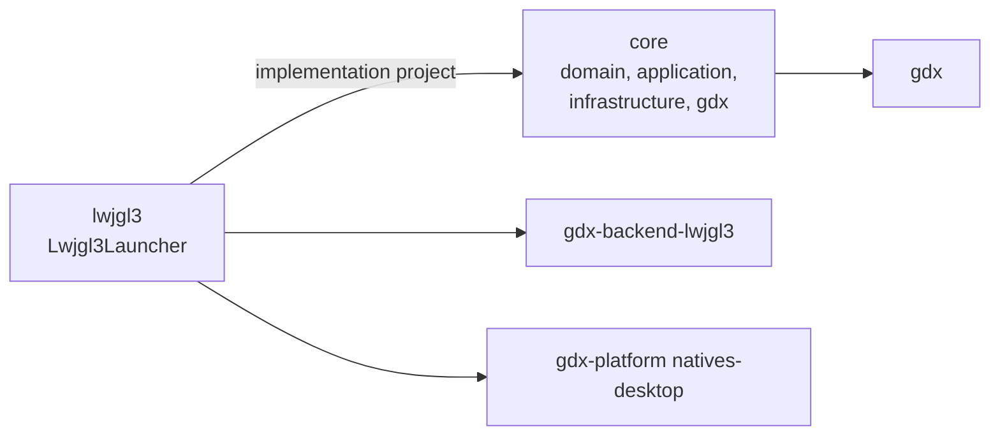
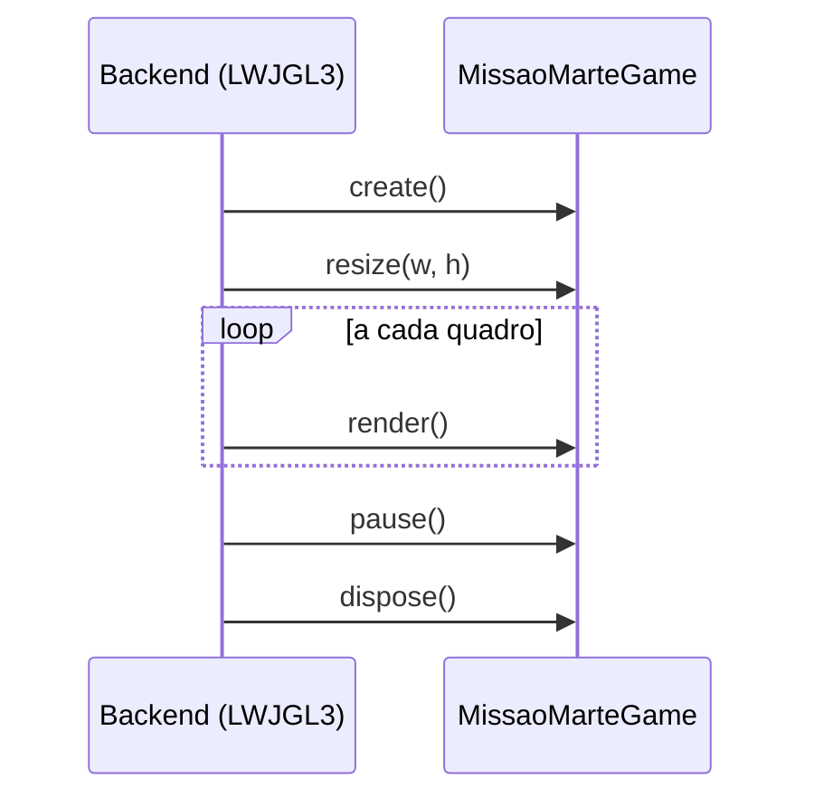
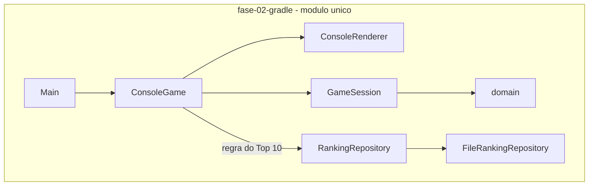
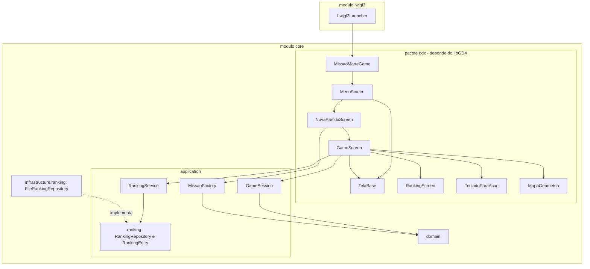
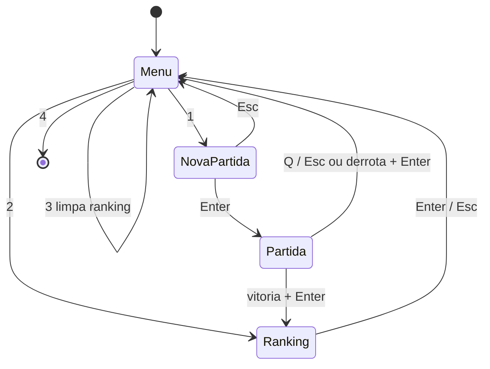

# Fase 03 - Tutorial de Introdução ao libGDX

## 1. Introdução

Na Fase 1 separamos as regras do jogo da interface e na Fase 2 migramos o build para o Gradle. Nesta fase trocamos a interface de console por uma **janela gráfica em libGDX**, sem reescrever as regras: `domain` e `application` continuam os mesmos e apenas uma nova camada (`gdx`) desenha o estado e lê o teclado.

O jogo continua **por turnos**: cada tecla válida processa um turno em `GameSession`. O loop do libGDX roda a ~60 quadros por segundo, mas só redesenha o estado atual. Sprites, sons, animações e HUD elaborado ficam para a Fase 4; aqui o visual usa retângulos coloridos (`ShapeRenderer`) e a fonte padrão (`BitmapFont`).

## 2. Objetivos de aprendizagem

- Entender o que é o libGDX e como ele organiza um jogo em módulos.
- Explicar o ciclo de vida `create()`, `render()`, `resize()`, `pause()`, `resume()` e `dispose()` e como `Game` e `Screen` o estendem.
- Montar um projeto Gradle multi-módulo (`core` e `lwjgl3`).
- Reaproveitar as regras existentes trocando só a interface.
- Tratar entrada de teclado com `InputProcessor` e converter teclas em `Acao`.
- Usar câmera e viewport para que a janela possa ser redimensionada.
- Isolar a conversão de coordenadas (eixo Y) em uma classe testável sem OpenGL.

## 3. Conceitos teóricos

Esta seção resume os conceitos e indica onde aprofundar no referencial [`tutorial-api-gradle-libgdx.md`](../../../../tutorial-api-gradle-libgdx.md). Os tópicos que o referencial não cobre foram complementados com a documentação oficial do libGDX.

### 3.1 O que é o libGDX

O libGDX é um **framework** Java para jogos multiplataforma (desktop, Android, iOS e web). Ele fornece gráficos (OpenGL), áudio, entrada, arquivos e utilitários, mas **não impõe uma arquitetura de jogo**: você escolhe como organizar o código. A mesma lógica roda em várias plataformas porque cada uma tem um *backend* próprio.

| Módulo/artefato | Papel | Usado nesta fase |
|---|---|---|
| `gdx` | API principal, independente de plataforma | sim, no `core` |
| `gdx-backend-lwjgl3` | Janela e OpenGL no desktop (LWJGL3) | sim, no `lwjgl3` |
| `gdx-platform` (`natives-desktop`) | Bibliotecas nativas do desktop | sim, no `lwjgl3` |
| Backends Android, iOS, HTML | Outras plataformas | não (Fase 6 usa Android) |

No papel de framework, o libGDX fica entre o código de baixo nível (OpenGL, acessado via LWJGL) e o desenvolvedor, oferecendo uma API de alto nível. Diferente de Unity ou Godot, **não tem editor visual**: o jogo inteiro é escrito em código, o que o torna adequado para estudar orientação a objetos aplicada a jogos.



Referencial: Parte 3, seção 3.2 (o que é a libGDX e seu posicionamento).

### 3.2 Origem, licença e linha do tempo

| Item | Detalhe |
|---|---|
| Criador | Mario Zechner, que começou o projeto em 2009 para escrever jogos em Java que rodassem no desktop e no Android sem reescrever o código |
| Primeira versão pública | 2010 |
| Licença | Apache 2.0: gratuita, uso comercial e educacional, sem royalties |
| Linguagem | Java na API; código nativo (C/C++, via JNI) por baixo para renderização, áudio, Box2D e arquivos |
| Repositório e site | `github.com/libgdx/libgdx` e `libgdx.com` |

Marcos relevantes para este projeto:

- **1.0** (2014): primeira versão estável.
- **Série 1.9**: introdução do backend **LWJGL3**, o que usamos no desktop, e, na 1.9.13, suporte a Java 11 ou superior.
- **1.12.0**: o `gdx-liftoff` passa a ser o gerador oficial de projetos.
- **1.12.1**: versão adotada nesta fase.

Referencial: Parte 3, seção 3.1 (história e origem).

### 3.3 Características principais

**Multiplataforma.** O código do jogo fica no módulo `core` e é compartilhado; só o launcher muda de uma plataforma para outra.

| Plataforma | Backend | Como funciona |
|---|---|---|
| Desktop (Windows, macOS, Linux) | LWJGL3 | Java com OpenGL via LWJGL |
| Android | Android | OpenGL ES nativo (Fase 6) |
| iOS | RoboVM ou MOE | Compila Java para código nativo da Apple |
| Web | GWT | Converte Java para JavaScript com WebGL |

**Acesso aos módulos pela classe `Gdx`.** Depois que o backend inicia, a classe `Gdx` expõe, de forma estática, os serviços da plataforma:

| Atributo | Serviço | Uso nesta fase |
|---|---|---|
| `Gdx.graphics` | Resolução, `delta`, renderização | `getWidth()` e `getHeight()` em `create()` |
| `Gdx.input` | Teclado, mouse, toque | `setInputProcessor(...)` em cada tela |
| `Gdx.app` | Log e controle da aplicação | `log(...)` no ciclo de vida e `exit()` no menu |
| `Gdx.audio` | Sons e músicas | não (Fase 4) |
| `Gdx.files` | Leitura e gravação de arquivos | não (o ranking usa `java.nio`) |
| `Gdx.net` | Requisições HTTP | não (Fase 5 usará a API REST) |

Referencial: Parte 3, seção 3.3 (características e módulos).

### 3.4 Principais classes da API

| Classe | Papel | Na Fase 3 |
|---|---|---|
| `Game` | Classe base do jogo; gerencia as `Screen` | Sim: `MissaoMarteGame` |
| `Screen` | Interface de uma tela | Sim: `TelaBase` e as quatro telas |
| `SpriteBatch` | Desenha imagens e texto em lote | Sim, só para texto |
| `ShapeRenderer` | Desenha formas geométricas | Sim: células, objetos e grade |
| `BitmapFont` | Desenha texto com uma fonte | Sim: fonte padrão |
| `OrthographicCamera` | Câmera 2D | Sim |
| `Texture` e `TextureAtlas` | Imagens na GPU, avulsas ou empacotadas | Não (Fase 4) |
| `Circle`, `Rectangle`, `Intersector` | Formas e testes de colisão | Não: a colisão aqui é por célula, regra do domínio |
| `MathUtils` | Funções matemáticas e números aleatórios | Não: o projeto usa `java.util.Random` |
| `Array<T>` | Lista otimizada para jogos | Não: o domínio usa `java.util.List` |
| `Sound` e `Music` | Efeitos curtos e músicas | Não (Fase 4) |
| `Box2D` | Física 2D | Não previsto |

Classes usadas nesta fase que o referencial não detalha: `FitViewport`, `GlyphLayout`, `InputAdapter`, `ScreenUtils`.

### 3.5 Versões e a escolha da 1.12.1

A versão da libGDX é fixada em um único lugar, o `ext { gdxVersion = '1.12.1' }` do `build.gradle` raiz, e todas as dependências a usam (`$gdxVersion`). Assim a API (`gdx`), o backend (`gdx-backend-lwjgl3`) e as bibliotecas nativas (`gdx-platform`) ficam sempre na mesma versão.

- O referencial recomenda a versão estável mais recente e adota a 1.12.1.
- Na verificação feita para esta fase, a mais recente no Maven Central era a **1.14.2**. Mantivemos a 1.12.1 para seguir o referencial e o ambiente já validado (JDK 17 e Gradle 8.7).
- Atualizar significa mudar `gdxVersion`, compilar, rodar os testes e consultar o artigo oficial *Updating your libGDX version* (<https://libgdx.com/wiki/articles/updating-libgdx>).
- O referencial indica 2024 como ano da 1.12.1, mas os artefatos no Maven Central são de novembro de 2023. Confie na página oficial de versões.

Referencial: Parte 3, seção 3.4 (versões da libGDX).

### 3.6 Projeto multi-módulo

O código independente de plataforma fica em `core`; cada plataforma tem um módulo fino que apenas inicia a janela e entrega o jogo ao `core`.



`settings.gradle` lista os módulos e `build.gradle` da raiz fixa a versão (`gdxVersion = '1.12.1'`) em um único lugar. Quando a Fase 6 adicionar um módulo `android`, o `core` será reaproveitado sem mudanças.

**Por que o libGDX usa Gradle.** O referencial dá três motivos: (1) um jogo multiplataforma precisa de vários módulos, cada um com dependências diferentes; (2) as bibliotecas nativas (`.dll`, `.so`, `.dylib`) de cada plataforma são baixadas e associadas pelo Gradle; (3) o Android exige Gradle.

| Módulo | Dependências | Papel |
|---|---|---|
| `core` | `gdx` | Jogo e telas; não conhece a plataforma |
| `lwjgl3` | `project(':core')`, `gdx-backend-lwjgl3`, `gdx-platform:natives-desktop` | Cria a janela, configura-a e entrega o jogo ao `core` |
| `android` (Fase 6) | `project(':core')`, `gdx-backend-android` | Mesmo papel, para Android |

Nota: o referencial declara as bibliotecas nativas como `runtimeOnly` na seção 3.5 e como `implementation` na Parte 8. Este projeto segue a Parte 8; `runtimeOnly` também funcionaria, pois as bibliotecas nativas só são necessárias na execução.

O projeto desta fase foi montado a partir do código existente, e não gerado pelo `gdx-liftoff`, justamente para reaproveitar `domain` e `application`.

Referencial: Parte 2, seção 2.11 (projeto multi-módulo), Parte 3, seção 3.5 ("Por que a libGDX usa Gradle?") e Parte 8 (`settings.gradle`, `build.gradle` raiz, `core` e `lwjgl3`).

### 3.7 Ciclo de vida da aplicação

Um jogo libGDX implementa `ApplicationListener`. O backend chama os métodos nesta ordem:

| Método | Quando é chamado |
|---|---|
| `create()` | Uma vez, ao iniciar. Aqui se criam os recursos (câmera, `SpriteBatch`, fonte). |
| `resize(w, h)` | Uma vez logo após `create()` e a cada mudança de tamanho da janela. |
| `render()` | A cada quadro. É o "corpo" do loop principal: entrada, atualização e desenho. |
| `pause()` | No desktop, ao minimizar a janela e logo antes de `dispose()` ao sair. |
| `resume()` | No desktop, ao restaurar a janela. |
| `dispose()` | Ao encerrar. Libera recursos de vídeo (VRAM). |



Referencial: Parte 5, seção 4.1 (Game Loop). Complemento: documentação oficial, página *The life cycle* (<https://libgdx.com/wiki/app/the-life-cycle>).

### 3.8 Game e Screen

`Game` implementa `ApplicationListener` e delega `render`, `resize`, `pause`, `resume` e `dispose` à **tela atual**. Cada tela implementa `Screen`:

| Método de `Screen` | Quando é chamado |
|---|---|
| `show()` | Quando a tela passa a ser a atual (`Game.setScreen`). |
| `render(delta)` | A cada quadro enquanto for a tela atual. `delta` é o tempo desde o quadro anterior. |
| `resize(w, h)` | Na mudança de tamanho e logo após `show()` em `setScreen`. |
| `pause()`, `resume()` | Repassados pelo `Game`. |
| `hide()` | Quando outra tela assume. |
| `dispose()` | **Não** é chamado automaticamente pelo `Game`; cada tela decide. |

Cada tela tem uma responsabilidade única (SRP), e `setScreen` troca o "estado" do jogo, o que corresponde ao padrão State.

```text
ApplicationListener          (interface do libGDX)
        ^
        | implementa
      Game
        ^
        | estende
MissaoMarteGame ---- setScreen ----> MenuScreen, NovaPartidaScreen, GameScreen, RankingScreen
                                      (todas estendem TelaBase, que implementa Screen)
```

**Onde está o loop principal?** O libGDX é orientado a eventos e não expõe um `while` explícito; `render()` faz o papel do corpo do loop, chamado cerca de 60 vezes por segundo. Em um jogo em tempo real (como o exemplo do referencial), `render()` lê a entrada, atualiza as posições usando `delta` e desenha. No Missão Marte a atualização é por turno:

| | Jogo em tempo real (referencial) | Missão Marte por turnos (esta fase) |
|---|---|---|
| Entrada | Lida a cada quadro | Evento `keyDown` |
| Atualização | Em `render()`, proporcional a `delta` | Em `GameSession.processarAcao`, um turno por tecla |
| `render()` | Atualiza e desenha | Só desenha o estado atual |
| Uso de `delta` | Essencial | Irrelevante (usado apenas no cursor piscante) |

Referencial: Parte 5, seções 4.1 a 4.3 (Game Loop, conceito de Screen e diagrama de classes).

### 3.9 Câmera e viewport

O jogo é desenhado em um espaço lógico de 800 x 600 unidades. O `FitViewport` mantém essa proporção ao redimensionar a janela, acrescentando barras pretas quando necessário, e atualiza a `OrthographicCamera`. Em `resize()` basta chamar `viewport.update(w, h, true)`. Antes de desenhar, chama-se `viewport.apply()` e informa-se `camera.combined` ao `SpriteBatch` e ao `ShapeRenderer`.

Complemento oficial: página *Viewports* (<https://libgdx.com/wiki/graphics/viewports>) e artigo *Coordinate Systems* (<https://libgdx.com/wiki/articles/coordinate-systems>). O referencial não cobre esse tópico.

### 3.10 Desenho: SpriteBatch, ShapeRenderer e BitmapFont

| Classe | Uso nesta fase |
|---|---|
| `ShapeRenderer` | Retângulos preenchidos (células e objetos) e linhas (grade). Alternativa sem imagens do referencial (Parte 7). |
| `SpriteBatch` | Envia texto para a GPU em lote (`begin()` ... `end()`). Texturas e sprites só na Fase 4. |
| `BitmapFont` | Fonte padrão embutida no jar do libGDX; desenha texto. |
| `GlyphLayout` | Mede o texto para centralizá-lo. |

Regra prática: não misture `ShapeRenderer` e `SpriteBatch` ao mesmo tempo; termine um (`end()`) antes de iniciar o outro.

Detalhes que aparecem no código da fase:

- **`ShapeRenderer`**: `begin(ShapeType.Filled)` desenha formas preenchidas e `begin(ShapeType.Line)` desenha contornos. A cor é definida com `setColor(...)` antes de cada forma, e uma forma desenhada depois cobre as anteriores. Por isso `GameScreen` desenha em **camadas**, com a nave por último.
- **Projeção**: tanto o `SpriteBatch` quanto o `ShapeRenderer` precisam receber `setProjectionMatrix(camera.combined)`; sem isso, o desenho ignora câmera e viewport.
- **`BitmapFont`**: `new BitmapFont()` carrega a fonte padrão embutida no `gdx-1.12.1.jar` (`lsans-15`), que tem glifos até o código 255 (Latin-1, conferido no jar). `getData().setScale(...)` aumenta ou reduz o texto, e `draw(batch, texto, x, y)` usa **y como o topo** do texto, que é desenhado para baixo a partir desse ponto (por isso `textoCentralizado` soma metade da altura ao centro desejado).
- **`GlyphLayout`**: mede largura e altura do texto antes de desenhá-lo, o que permite centralizá-lo (`textoCentralizado` em `TelaBase`). Com a variante `draw(batch, texto, x, y, largura, alinhamento, quebra)` o texto quebra linhas automaticamente (usada nas mensagens do painel).
- **Ordem de um quadro**: limpar a tela, desenhar o mundo (formas) e, por último, o HUD (texto), para que o HUD apareça por cima.

Referencial: Parte 3, seção 3.3 (principais classes), Parte 6 (estrutura de `GameScreen`) e Parte 7 (alternativa com `ShapeRenderer`).

### 3.11 Entrada de teclado

O libGDX usa o padrão Observer: um `InputProcessor` recebe `keyDown`, `keyUp` e `keyTyped`. `InputAdapter` fornece implementações vazias. Os eventos chegam na thread de renderização, logo antes de `render()`.

- `keyDown(int keycode)`: tecla pressionada; o código vem de `Input.Keys`. Usada para os comandos do jogo.
- `keyTyped(char c)`: caractere gerado pelo teclado. Usada para digitar o nome do piloto.
- O retorno `true` indica que o evento foi tratado.

Complemento oficial: página *Event handling* (<https://libgdx.com/wiki/input/event-handling>).

### 3.12 Gerenciamento de memória e `dispose()`

Objetos como `SpriteBatch`, `ShapeRenderer`, `BitmapFont`, `Texture`, `Sound` e `Music` guardam recursos nativos ou de vídeo, que o coletor de lixo do Java **não** libera. Por isso o libGDX os marca como descartáveis (`Disposable`) e exige uma chamada explícita a `dispose()`.

- Crie os recursos uma vez (em `create()` ou `show()`) e libere-os em `dispose()`.
- Compartilhe recursos pesados em vez de criá-los por objeto ou por quadro. O referencial dá o exemplo de uma `Texture` estática compartilhada por todos os projéteis.
- Nunca crie `new BitmapFont()` ou `new ShapeRenderer()` dentro de `render()`: o jogo vazaria memória a cada quadro.

Neste projeto, `MissaoMarteGame` cria câmera, viewport, `SpriteBatch`, `ShapeRenderer` e fonte em `create()` e libera os três descartáveis em `dispose()`. As telas não possuem recursos próprios, o que também resolve o fato de o `Game` não chamar o `dispose()` delas.

Complemento oficial: artigo *Memory Management* (<https://libgdx.com/wiki/articles/memory-management>).

Referencial: Parte 3, seções 3.8 e 3.9 (regras de `dispose` para `Texture`, `Sound` e `Music`).

### 3.13 Ecossistema e alternativas

| Ferramenta | Para que serve |
|---|---|
| `gdx-liftoff` | Gerador oficial de projetos libGDX (nesta fase o projeto foi montado à mão, para reaproveitar o código) |
| Texture Packer | Empacota várias imagens em um `TextureAtlas` (Fase 4) |
| Hiero | Gera `BitmapFont` a partir de fontes TrueType |
| Particle Editor | Editor visual de partículas |

Extensões populares, não oficiais: Ashley (ECS), TiledMap (mapas do editor Tiled), VisUI (componentes de interface) e gdx-ai (pathfinding e IA). O Box2D, de física 2D, acompanha a libGDX.

Alternativas e como se comparam:

| Opção | Tipo | Observação |
|---|---|---|
| libGDX | Framework em código (Java/Kotlin) | Você vê como tudo funciona; ideal para aprender |
| Unity, Godot, Unreal | Engines visuais | Editor e scripts; mais produtividade, menos transparência |
| LWJGL | Biblioteca de baixo nível | O que o libGDX usa por baixo no desktop |
| MonoGame | Framework em código (C#) | Equivalente ao libGDX no ecossistema .NET |

Os conceitos aprendidos aqui (game loop, câmera, renderização em lote, ciclo de vida) se aplicam a qualquer engine.

Referencial: Parte 3, seções 3.6 (alternativas) e 3.7 (ecossistema).

### 3.14 Prévia da Fase 4: sprites, sons, HUD e colisões

O referencial cobre mais do que esta fase usa. Estes tópicos serão aplicados na Fase 4; vale conhecê-los agora:

**Sprites e texturas.** Um sprite é uma imagem 2D que representa um objeto. O caminho completo é: arquivo PNG, `Pixmap` (imagem na RAM, que também permite desenhar formas proceduralmente), `Texture` (imagem na GPU) e `Sprite` (textura com posição, tamanho e rotação), desenhado com `sprite.draw(batch)` entre `batch.begin()` e `batch.end()`. O `SpriteBatch` acumula as chamadas e as envia à GPU de uma só vez, reduzindo as chamadas de desenho.

**Sons.**

| | `Sound` | `Music` |
|---|---|---|
| Uso | Efeitos curtos (tiro, explosão) | Trilha sonora |
| Carregamento | Inteiro na memória | Em fluxo, lido do disco aos poucos |
| Simultaneidade | Vários ao mesmo tempo | Uma instância por vez |
| API | `play(volume)` | `play()` e `setLooping(true)` |

**HUD.** É a camada de interface sobreposta ao jogo (pontuação, vidas, barras). É desenhada depois dos elementos do jogo, com `BitmapFont` para texto e `ShapeRenderer` para barras. O painel lateral desta fase já segue essa ideia de forma simples.

**Colisões.** O referencial usa hitboxes (`Circle`, `Rectangle`) e `Intersector.overlaps(...)`, preferindo a forma mais simples possível e uma hitbox um pouco menor que o desenho. **O Missão Marte é diferente**: a colisão é decidida pela regra do domínio, comparando a `Posicao` da nave com a dos perigos (`Missao.houveColisaoComPerigo()`), sem geometria. Na Fase 4 a regra de negócio será preservada e animações, como uma explosão, serão apenas efeito visual disparado a partir do `ResultadoTurno`.

Referencial: Parte 3, seções 3.8 (sprites e texturas), 3.9 (sons), 3.10 (HUD) e 3.11 (colisões).

### 3.15 Onde cada conceito aparece no código

| Conceito | Onde na Fase 3 |
|---|---|
| `Game` e ciclo de vida da aplicação | `MissaoMarteGame` (`create`, `dispose`) |
| `Screen` e seus métodos | `TelaBase` e as quatro telas (`show`, `render`, `resize`, `pause`, `resume`, `hide`, `dispose`) |
| Câmera e viewport | `MissaoMarteGame` (criação) e `TelaBase` (`resize` e `render`) |
| `ShapeRenderer` | `GameScreen.desenharCelulasEObjetos` e `desenharFimDePartida` |
| `SpriteBatch`, `BitmapFont`, `GlyphLayout` | Métodos `texto*` de `TelaBase` e `GameScreen.desenharPainel` |
| `InputProcessor` e `InputAdapter` | `show()` de cada tela |
| `Input.Keys` | `TecladoParaAcao` |
| `Gdx.app.log` e `Gdx.app.exit` | `TelaBase.log` e `MenuScreen` |
| Backend LWJGL3 e configuração da janela | `Lwjgl3Launcher` |
| Gerenciamento de memória | `MissaoMarteGame.dispose()` |

## 4. Problemas encontrados no código original

Pontos da Fase 2 que atrapalhariam a adaptação para uma janela gráfica:

| Problema | Onde estava | Consequência |
|---|---|---|
| Regra do Top 10 misturada ao fluxo de console | `ConsoleGame.processarVitoria` e `deveEntrarNoRanking` | Uma tela gráfica teria de **copiar** a regra. |
| Porta de ranking em `infrastructure` | `RankingRepository` e `RankingEntry` | Uma regra de ranking em `application` importaria `infrastructure`, violando a regra de dependência da Fase 1. |
| Entrada e saída presas ao `System.in` e `System.out` | `ConsoleGame`, `ConsoleRenderer` | Não servem para uma janela. |
| Y crescendo para baixo | `Acao.CIMA` é `y - 1` | No libGDX o Y cresce para cima; a conversão precisa ficar em um só lugar. |
| Build de módulo único | `build.gradle` da Fase 2 | Não separa código de plataforma do código do jogo. |

Já estavam prontos para a troca: `GameSession.processarAcao(Acao)` devolve `ResultadoTurno` sem imprimir, e `ObjetoRenderizavel` expõe posição e símbolo.

## 5. Arquitetura antes da transformação



## 6. Passo a passo da implementação

Cada etapa compila e roda, o que permite adaptar o jogo gradualmente.

**Etapa 1 - Esqueleto multi-módulo**

1. Criar `fase-03-libgdx` e copiar `gradlew`, `gradlew.bat` e `gradle/wrapper` da Fase 2 (wrapper 8.7).
2. Criar `settings.gradle`, `build.gradle` (raiz), `core/build.gradle` e `lwjgl3/build.gradle` (seção 7).
3. Copiar `domain`, `application` e `infrastructure/ranking/FileRankingRepository` da Fase 2 para `core/src/main/java`, e os testes para `core/src/test/java`. **Não copiar** `Main`, `ConsoleGame` e `ConsoleRenderer`.
4. Mover `RankingRepository` e `RankingEntry` para o pacote `application.ranking` e ajustar os imports de `FileRankingRepository` e do seu teste.
5. Criar `MissaoMarteGame` e `Lwjgl3Launcher` e rodar `gradlew :lwjgl3:run`.

**Etapa 2 - Telas e navegação**

6. Criar `TelaBase` (log do ciclo de vida, limpeza da tela, viewport) e `MenuScreen`.

**Etapa 3 - Partida**

7. Criar `TecladoParaAcao` e `MapaGeometria` (com testes).
8. Criar `GameScreen`: desenha a grade 11 x 11, os objetos, o painel e as mensagens do turno.

**Etapa 4 - Fim de partida e ranking**

9. Criar `RankingService` (com testes) usando a porta `RankingRepository`.
10. Criar `NovaPartidaScreen` e `RankingScreen`, e ligar a vitória ao `RankingService`.

**Etapa 5 - Verificação**

11. `gradlew clean build` e `gradlew :lwjgl3:run`.

## 7. Código antes e depois

### 7.1 Build: módulo único para multi-módulo

Antes (Fase 2), um único `build.gradle` com o plugin `application` e o JUnit:

```groovy
plugins { id 'application' }
application { mainClass = 'br.edu.unifor.missaomarte.Main' }
dependencies { testImplementation 'org.junit.jupiter:junit-jupiter:5.10.2' }
```

Depois (Fase 3). A raiz fixa a versão e a configuração comum:

```groovy
// build.gradle (raiz)
ext { gdxVersion = '1.12.1' }
subprojects {
    apply plugin: 'java'
    repositories { mavenCentral() }
    // Java 17 e UTF-8 nas tarefas de compilacao
}
```

`core/build.gradle` depende só da API do libGDX; `lwjgl3/build.gradle` depende do `core` e do backend desktop:

```groovy
// core/build.gradle
dependencies { implementation "com.badlogicgames.gdx:gdx:$gdxVersion" }

// lwjgl3/build.gradle
apply plugin: 'application'
dependencies {
    implementation project(':core')
    implementation "com.badlogicgames.gdx:gdx-backend-lwjgl3:$gdxVersion"
    implementation "com.badlogicgames.gdx:gdx-platform:$gdxVersion:natives-desktop"
}
application { mainClass = 'br.edu.unifor.missaomarte.lwjgl3.Lwjgl3Launcher' }
run { workingDir = rootProject.projectDir }
```

### 7.2 Composition root: `Main` para `Lwjgl3Launcher`

Antes:

```java
ConsoleGame game = new ConsoleGame(new Scanner(System.in), new Random(),
        new ConsoleRenderer(), new MissaoFactory(), new FileRankingRepository(rankingPath));
game.run();
```

Depois:

```java
MissaoMarteGame jogo = new MissaoMarteGame(
        new MissaoFactory(),
        new RankingService(new FileRankingRepository(Paths.get("ranking.json"))),
        new Random());
// configuracao da janela 800x600, vsync, 60 FPS
new Lwjgl3Application(jogo, configuracao);
```

### 7.3 Entrada: texto para teclas

Antes, `ConsoleGame` lia uma linha e a traduzia:

```java
String entrada = scanner.nextLine();
Acao acao = Acao.fromInput(entrada);
ResultadoTurno resultado = session.processarAcao(acao);
renderer.imprimirMensagens(resultado.getMensagens());
```

Depois, `GameScreen` recebe o evento de tecla e usa o mesmo `GameSession`:

```java
Acao acao = TecladoParaAcao.converter(keycode);
if (acao == Acao.INVALIDA) {
    return false;               // tecla irrelevante: nao consome turno
}
ResultadoTurno resultado = session.processarAcao(acao);
mensagens = new ArrayList<>(resultado.getMensagens());
aplicarEstado(resultado.getEstado());
return true;
```

`GameSession` e `Acao` **não foram alterados**; só mudou quem produz a `Acao`.

### 7.4 Regra do ranking: do console para a aplicação

Antes, dentro de `ConsoleGame`:

```java
if (deveEntrarNoRanking(ranking, atual.getPontuacao())) {
    ranking.add(atual);
    ranking.sort(Comparator.comparingInt(RankingEntry::getPontuacao).reversed());
    while (ranking.size() > 10) { ranking.remove(ranking.size() - 1); }
    rankingRepository.salvarTop(ranking);
}
```

Depois, em `application.RankingService` (a tela só chama `registrarVitoria`):

```java
public boolean registrar(RankingEntry atual) {
    List<RankingEntry> ranking = new ArrayList<>(repositorio.carregarTop());
    if (!deveEntrar(ranking, atual.getPontuacao())) {
        return false;
    }
    ranking.add(atual);
    ranking.sort(Comparator.comparingInt(RankingEntry::getPontuacao).reversed());
    while (ranking.size() > TAMANHO_MAXIMO) { ranking.remove(ranking.size() - 1); }
    repositorio.salvarTop(ranking);
    return true;
}
```

### 7.5 Desenho: caracteres no console para formas na janela

Antes, `ConsoleRenderer` imprimia um caractere por célula. Depois, `GameScreen` desenha um retângulo por objeto e o símbolo sobre ele, em camadas (a nave por último para prevalecer):

```java
camadas.add(new Camada(List.of(missao.getBase()), COR_BASE));
camadas.add(new Camada(missao.getAsteroides(), COR_ASTEROIDE));
camadas.add(new Camada(missao.getInimigos(), COR_INIMIGO));
camadas.add(new Camada(missao.getPassageiros(), COR_PASSAGEIRO));
camadas.add(new Camada(List.of(missao.getNave()), COR_NAVE));
```

Como `ObjetoRenderizavel` já expõe `getPosicao()` e `getSimbolo()`, nenhuma classe de domínio foi alterada para ser desenhada.

## 8. Explicação das alterações

### 8.1 `MissaoMarteGame` (extends `Game`)

Cria a câmera, o `FitViewport`, o `SpriteBatch`, o `ShapeRenderer` e a fonte em `create()`, e os libera em `dispose()`. Recebe `MissaoFactory`, `RankingService` e `Random` pelo construtor (DIP). As telas pedem esses recursos ao jogo, então são **criados uma vez e compartilhados**.

Por que não criar recursos em cada tela? Porque `Game` não chama `dispose()` das telas: recursos por tela vazariam memória de vídeo.

### 8.2 `TelaBase` (template method)

`render()` fixa a sequência: limpar a tela, aplicar o viewport, configurar a projeção e chamar `desenhar(delta)`. Também registra no log cada passagem por `show()`, `resize()`, `pause()`, `resume()`, `hide()` e `dispose()`, o que permite **observar o ciclo de vida** executando o jogo. Em `hide()` ela remove o `InputProcessor`, para que uma tela nunca receba eventos da outra.

### 8.3 Telas

| Tela | Responsabilidade |
|---|---|
| `MenuScreen` | Navegação: 1 Jogar, 2 Ver ranking, 3 Limpar ranking, 4 Sair. |
| `NovaPartidaScreen` | Nome (via `keyTyped`) e dificuldade; cria a `GameSession` com a fábrica e as regras existentes. |
| `GameScreen` | Desenha o mapa e o painel; converte teclas em `Acao`; mostra o fim de partida. |
| `RankingScreen` | Mostra o Top 10 e, após uma vitória, o resumo da partida. |

`GameScreen` age como **Controller de interface (GRASP)**: não contém regra de jogo, só traduz entrada, chama a sessão e desenha o estado. O nome aceita apenas ASCII simples por simplicidade: evita caracteres fora da faixa de glifos da fonte padrão e dispensa validar layouts de teclado diferentes.

### 8.4 `TecladoParaAcao` (Adapter / Indirection)

Mapeia `Keys.W/UP`, `S/DOWN`, `A/LEFT`, `D/RIGHT`, `E`, `Q/ESCAPE` em `Acao`; qualquer outra tecla vira `INVALIDA` e é ignorada sem consumir turno. Na Fase 6, toque na tela ou controle Bluetooth produzirão as mesmas `Acao`, sem tocar em `GameSession`.

### 8.5 `MapaGeometria` (Pure Fabrication)

Converte coordenadas de célula em coordenadas de tela:

```java
public float yCanto(int y) {
    return origemY + (max - y) * celula;   // Y do jogo cresce para baixo; o da tela, para cima
}
```

A inversão do eixo Y fica **somente aqui**. Como a classe não depende de OpenGL, é testada por unidade (`MapaGeometriaTest`).

### 8.6 `RankingService` e a porta de ranking

`RankingRepository` e `RankingEntry` foram movidos para `application.ranking`: a interface é a "porta" que a aplicação define, e `FileRankingRepository` (em `infrastructure.ranking`) é o "adaptador" que a implementa. Assim `application` não importa `infrastructure` e `RankingService` pode ser testado com um repositório em memória.

### 8.7 O que **não** mudou

- Os 13 arquivos de `domain` e os 7 de `application` copiados da Fase 2 são idênticos (comparação por hash); o único arquivo novo em `application` é `RankingService`.
- `FileRankingRepository` só ganhou os imports da nova localização da porta.
- As regras do jogo, a pontuação, a dificuldade e a vitória são as mesmas.

### 8.8 Padrões usados

| Padrão | Onde | Por quê |
|---|---|---|
| State | `Game` + `Screen` | O libGDX já modela telas como estados; cada uma tem uma responsabilidade. |
| Template Method | `TelaBase.render()` | Evita repetir a preparação do quadro em cada tela. |
| Adapter / Indirection | `TecladoParaAcao` | Isola a API de teclado da regra de jogo. |
| Pure Fabrication | `MapaGeometria`, `RankingService` | Lógica testável, fora das classes de domínio e de OpenGL. |
| Port and Adapter (DIP) | `RankingRepository` / `FileRankingRepository` | A regra de ranking não depende de arquivo. |
| Observer | `InputProcessor` | Mecanismo do próprio libGDX para entrada. |
| Injeção de dependência manual | `Lwjgl3Launcher` | Único lugar que conhece as implementações concretas. |

### 8.9 Limitações conhecidas

- A legenda do painel ainda obtém os símbolos instanciando objetos de exemplo (limitação herdada da Fase 1).
- As mensagens de `GameSession` e os textos das telas estão sem acento, seguindo a convenção do código-fonte do projeto. Não é limitação do libGDX: a fonte padrão (`lsans-15`) tem glifos até o código 255 (Latin-1, verificado no `gdx-1.12.1.jar`), então acentuar é possível (exercício 9).
- `GameSession` ainda recebe `Random` e `min/max` diretamente.
- O desenho usa cores por categoria; não há texturas, animações, sons nem HUD formal (Fase 4).
- `Dificuldade` e `MissaoFactory.criarPassageiroAleatorio` continuam com `switch`/`if` (OCP parcial).
- A janela não foi testada em macOS nem Linux; a configuração `-XstartOnFirstThread` está no `run` mas não foi exercitada.

## 9. Arquitetura resultante



Regra de dependência: `domain`, `application` e `infrastructure` **não importam** `com.badlogic`; só o pacote `gdx` (e o módulo `lwjgl3`) conhecem o libGDX. Isso foi verificado por busca nos fontes.



## 10. Como executar e testar

### 10.1 Comandos

Na pasta `fase-03-libgdx`:

```powershell
.\gradlew.bat --version                         # Gradle 8.7 e JVM 17
.\gradlew.bat clean build                       # compila e executa os testes
.\gradlew.bat :lwjgl3:run --console=plain       # abre a janela
```

### 10.2 Testes automatizados

`gradlew clean build` executa **39 testes**: os 28 herdados da Fase 2 (agora em `core`, com apenas o ajuste de import em `FileRankingRepositoryTest`) mais 11 novos:

| Teste | O que verifica |
|---|---|
| `TecladoParaAcaoTest` (3) | WASD e setas, embarcar, sair e teclas desconhecidas. |
| `MapaGeometriaTest` (3) | Inversão do eixo Y, X crescente e centro da célula. |
| `RankingServiceTest` (5) | Zero/negativo não entra, ordenação, limite de 10, corte pelo pior e limpar. |

### 10.3 Observando o ciclo de vida

Ao executar, o terminal mostra o log do ciclo de vida. Uma sessão típica (menu, nova partida, partida, abortar, ranking, sair):

```text
[MissaoMarte] create(): janela 800x600
[MissaoMarte] MenuScreen.show()
[MissaoMarte] MenuScreen.resize(800, 600)
[MissaoMarte] MenuScreen.resize(800, 600)
[MissaoMarte] MenuScreen.hide()
[MissaoMarte] NovaPartidaScreen.show()
...
[MissaoMarte] MenuScreen.pause()
[MissaoMarte] dispose()
[MissaoMarte] MenuScreen.hide()
```

Pontos para discutir:

- `resize` aparece **duas vezes** no início: uma por `Game.setScreen` (chamada logo após `show()`) e outra pelo backend, depois de `create()`.
- `pause()` vem **antes** de `dispose()` ao fechar a janela no desktop.
- `Game.dispose()` chama `hide()` da tela atual, mas não `dispose()` dela.

### 10.4 Validação realizada

| Verificação | Resultado |
|---|---|
| `gradlew --version` | Gradle 8.7, JVM 17.0.10 |
| `gradlew clean build` | Sucesso, 39 testes, 0 falhas |
| Janela abre e o log do ciclo de vida aparece | Sim |
| Teclas enviadas à janela (menu, nova partida, partida, `Q`, ranking, `Esc`, limpar ranking, sair) | Todas as transições esperadas no log, sem exceções |
| Imports de `com.badlogic` fora de `gdx` e `lwjgl3` | Nenhum |
| Hashes de `domain` e `application` contra a Fase 2 | Idênticos, exceto o novo `RankingService` |
| Fases 1 e 2 e `exercicio10/src` | Sem alterações |

**Não verificado automaticamente:** a aparência da janela (cores, alinhamento e legibilidade do texto) e os fluxos de vitória e derrota completos, pois a validação por terminal não vê a janela. Use o roteiro abaixo.

### 10.5 Roteiro de validação manual

1. Menu: opções 1 a 4; a opção 3 mostra "Ranking limpo."
2. Nova partida: digitar um nome, `Backspace`, mudar a dificuldade com as setas, `Esc` volta ao menu.
3. Partida: o mapa 11 x 11 aparece com a nave `N` e a base `B` no centro; `W` move a nave para **cima** na tela.
4. Embarcar com `E` em uma célula com passageiro e em uma sem passageiro; ver a mensagem no painel.
5. Levar passageiros à base e conferir "A bordo", "Entregues" e "Restantes no mapa".
6. Colidir com asteroide ou inimigo e conferir perda de vida e de pontos.
7. Vitória: caixa "MISSAO CUMPRIDA!", `Enter` mostra o ranking com o resumo.
8. Derrota (perder as vidas): "GAME OVER", `Enter` volta ao menu.
9. Redimensionar e minimizar a janela: o jogo mantém a proporção e o log mostra `resize()` e `pause()`/`resume()`.
10. Conferir que `ranking.json` aparece em `fase-03-libgdx` após uma vitória.

## 11. Exercícios para os alunos

1. Faça o log do ciclo de vida de `MissaoMarteGame` mostrar também `pause()` e `resume()` ao minimizar e restaurar a janela.
2. Troque `FitViewport` por `StretchViewport` e por `ExtendViewport` e descreva a diferença visual ao redimensionar.
3. Mude as cores das categorias em `GameScreen` e adicione um novo tipo de passageiro (veja o exercício 1 da Fase 1): ele aparece sem alterar `GameScreen`? Por quê?
4. Escreva um teste para `RankingService.registrarVitoria` usando uma `GameSession` real.
5. Crie `TecladoParaAcao` alternativo para as teclas `I/J/K/L` sem alterar `GameSession`.
6. Adicione uma tela de pausa (`PausaScreen`) acionada por `P` e retorne à partida sem perder o estado.
7. Extraia uma interface para `MissaoFactory` e injete-a em `MissaoMarteGame` (DIP completo).
8. Explique por que `dispose()` das telas não é chamado pelo `Game` e proponha uma forma de liberar recursos por tela.
9. Acentue os textos das telas e confirme que a fonte padrão os desenha. Em seguida liste o que seria preciso para acentuar também as mensagens de `GameSession` sem acoplar o domínio ao libGDX.
10. Use o `Gdx.app.log` para registrar o tempo (`delta`) de alguns quadros em `render()` e explique por que ele não importa para um jogo por turnos, mas importaria para um jogo em tempo real.

## 12. Conclusão

A Fase 3 mostrou que a separação feita na Fase 1 compensa: trocar o console pelo libGDX exigiu apenas uma nova camada de apresentação (`gdx`), uma classe de aplicação (`RankingService`) e a reorganização do build em dois módulos. As regras do jogo permaneceram intactas e testadas.

O resultado é um jogo por turnos, com formas e fonte padrão, que ainda não tem a aparência final. A **Fase 4** substituirá os retângulos por sprites e texturas, adicionará animações, sons e um HUD completo, mantendo as regras de negócio e a arquitetura em camadas.
