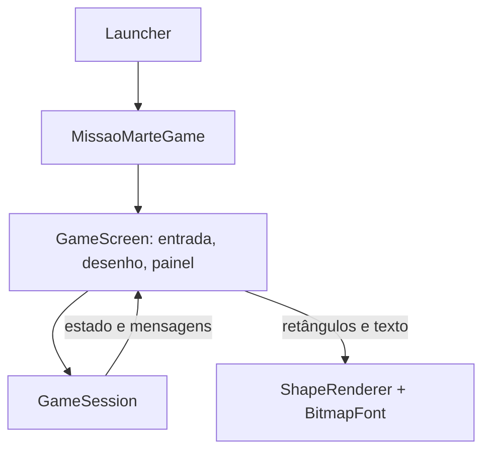
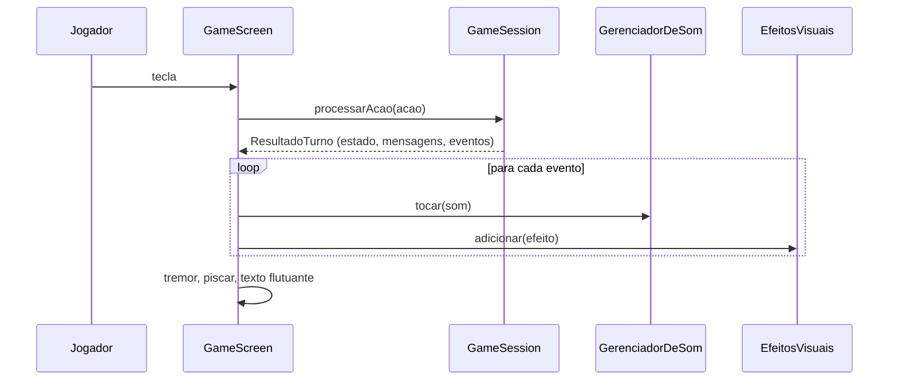
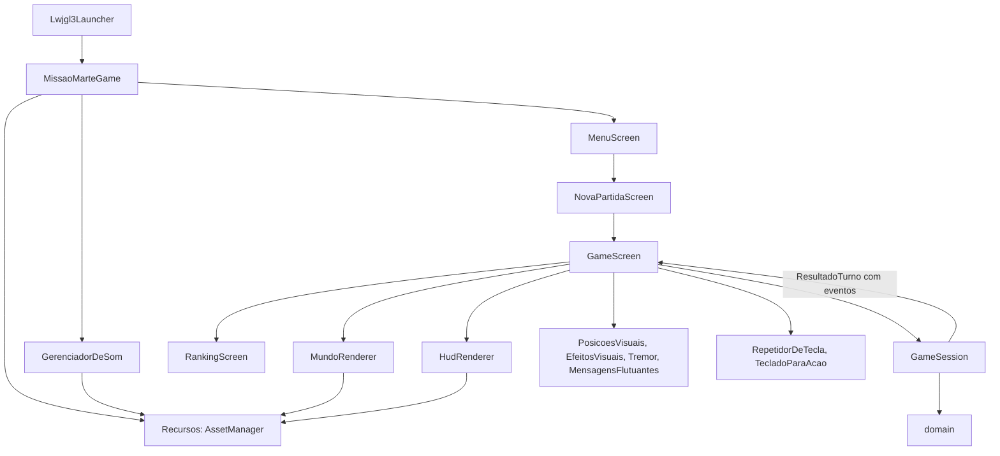

# Fase 04 - Tutorial de Interface Gráfica

## 1. Introdução

Na Fase 3 o jogo ganhou uma janela em libGDX, mas ainda desenhava retângulos coloridos e texto. Nesta fase a **apresentação** é transformada: sprites e texturas, movimento suave, animações, sons e um HUD completo. As regras de negócio **não mudam**: `domain` continua idêntico ao da Fase 3, e a única alteração em `application` é aditiva (a sessão passa a informar *o que aconteceu* em cada turno e a congelar a duração ao terminar).

O jogo segue por turnos. O que se movimenta e se anima é o desenho; a lógica continua instantânea e por tecla.

## 2. Objetivos de aprendizagem

- Carregar e organizar imagens e sons com o `AssetManager`.
- Entender a cadeia imagem (PNG), `Texture`, `TextureRegion` e animação por quadros.
- Separar a posição lógica (célula) da posição visual (desenho) para criar movimento suave.
- Reagir a eventos de jogo com sons, efeitos visuais, tremor e textos flutuantes, sem colocar regra na tela.
- Construir um HUD que apenas lê o estado da partida.
- Entender por que a colisão deste jogo não usa `Intersector`.
- Tratar entrada com repetição ao segurar a tecla.
- Testar a lógica de apresentação sem OpenGL nem áudio.

## 3. Conceitos teóricos

Esta seção resume os conceitos e indica onde aprofundar no referencial [`tutorial-api-gradle-libgdx.md`](../../../../tutorial-api-gradle-libgdx.md). Os tópicos que ele não cobre foram complementados com a documentação oficial do libGDX.

### 3.1 Sprites e texturas

Um *sprite* é uma imagem 2D que representa um objeto do jogo. O caminho completo é:

| Etapa | Classe | Onde fica | Observação |
|---|---|---|---|
| Arquivo | PNG em `assets` | Disco | `Gdx.files.internal(...)` |
| Imagem na RAM | `Pixmap` | CPU | Permite desenhar proceduralmente |
| Imagem na GPU | `Texture` | VRAM | Deve ser liberada com `dispose()` |
| Parte de uma textura | `TextureRegion` | Referência | Não copia pixels; é a "janela" para um quadro |
| Textura com posição e rotação | `Sprite` | Objeto de jogo | Não é usada nesta fase |

Nesta fase os PNG viram `Texture` pelo `AssetManager` e cada quadro é uma `TextureRegion`, desenhada com `SpriteBatch.draw(...)`. O `SpriteBatch` acumula os desenhos entre `begin()` e `end()` e os envia à GPU de uma vez, o que reduz as chamadas de desenho. Referencial: Parte 3, seção "Sprites e Texturas".

### 3.2 AssetManager

O `AssetManager` é a forma recomendada de carregar e gerenciar recursos. Ele centraliza o acesso, conta referências e libera tudo com um único `dispose()`.

```java
gerenciador.load("imagens/nave.png", Texture.class);   // enfileira
gerenciador.finishLoading();                           // bloqueia até terminar
Texture t = gerenciador.get("imagens/nave.png", Texture.class);
```

Pontos importantes:

- `load()` só **enfileira**; nada é carregado até `update()` ou `finishLoading()`. Em um jogo grande usa-se `update()` em uma tela de carregamento; aqui são 25 arquivos pequenos, então `finishLoading()` basta.
- Recursos carregados pelo gerenciador **não** se liberam manualmente: use `unload()` ou `dispose()` do gerenciador.
- O `AssetManager` não deve ser `static`: no Android isso causa texturas pretas ou ausentes.

Complemento oficial: *Managing your assets* (<https://libgdx.com/wiki/managing-your-assets>). O referencial não cobre o `AssetManager`.

### 3.3 Animação por quadros

Uma animação é uma sequência de imagens mostradas em intervalos fixos. A classe `Animation<T>` guarda os quadros e a duração de cada um; `getKeyFrame(tempo, laco)` devolve o quadro correspondente ao tempo acumulado.

```java
TextureRegion[][] grade = TextureRegion.split(textura, 48, 48);   // faixa horizontal de quadros
Animation<TextureRegion> baseAnim = new Animation<>(0.25f, grade[0]);
TextureRegion quadro = baseAnim.getKeyFrame(tempo, true);        // true = em laço
```

- Os quadros ficam lado a lado em uma só imagem (faixa ou *sprite sheet*); `split` os recorta.
- Animações **em laço** (propulsor, base, inimigo) usam o tempo da tela.
- Animações **de uma execução** (explosão, brilho) guardam o próprio tempo e somem ao terminar.
- Não use `Sprite` como quadro de animação: ele carrega posição, que não passa de um quadro para outro.

Complemento oficial: *2D Animation* (<https://libgdx.com/wiki/graphics/2d/2d-animation>). O referencial não cobre animação por quadros; ele usa um efeito de explosão desenhado com `ShapeRenderer`.

### 3.4 Sons e áudio

| | `Sound` | `Music` |
|---|---|---|
| Uso | Efeitos curtos | Trilha sonora |
| Carregamento | Inteiro na memória | Em fluxo, lido aos poucos |
| Simultaneidade | Vários ao mesmo tempo | Uma instância por vez |
| API principal | `play(volume)` | `play()`, `pause()`, `setLooping(true)`, `setVolume(...)` |

Ambos precisam de `dispose()` (aqui feito pelo `AssetManager`). Nesta fase há oito arquivos WAV: seis efeitos, um sinal de menu e a música. O backend desktop (LWJGL3 com OpenAL) toca WAV, OGG e MP3. Referencial: Parte 3, seção "Sons e Áudio".

### 3.5 HUD

O HUD (*Head-Up Display*) é a camada de interface sobreposta ao jogo: pontuação, vidas, progresso. É desenhado **depois** dos elementos do jogo, para aparecer por cima, e normalmente combina `ShapeRenderer` (barras e painéis) e `BitmapFont` (texto). Referencial: Parte 3, seção "HUD".

Detalhe técnico: para desenhar formas translúcidas (painéis com 45% de opacidade) é preciso habilitar a mistura (*blending*) antes do `ShapeRenderer`:

```java
Gdx.gl.glEnable(GL20.GL_BLEND);
Gdx.gl.glBlendFunc(GL20.GL_SRC_ALPHA, GL20.GL_ONE_MINUS_SRC_ALPHA);
```

### 3.6 Colisões: o referencial e este projeto

O referencial detecta colisão com formas geométricas (`Circle`, `Rectangle`) e `Intersector.overlaps(...)`, preferindo a forma mais simples e deixando a hitbox menor que o desenho. Isso serve a jogos em tempo real, em que os objetos ocupam posições contínuas.

O Missão Marte é diferente: a colisão é decidida por **igualdade de célula** (`Missao.houveColisaoComPerigo()`), regra do domínio, sem geometria. Por isso:

- **Não** usamos `Intersector`, e a regra não foi movida para a camada gráfica.
- O que esta fase adiciona é a **resposta** à colisão: explosão, tremor, flash vermelho, piscar da nave, texto "-6" e som, tudo disparado pelo evento `COLISAO`.
- O exercício 10 propõe comparar as duas abordagens.

Referencial: Parte 3, seção "Detecção de Colisões".

### 3.7 Entrada: eventos e repetição de tecla

O `InputProcessor` recebe `keyDown` uma vez por pressionamento. Para repetir uma ação enquanto a tecla é mantida (como andar várias casas), o libGDX oferece duas abordagens: consultar `Gdx.input.isKeyPressed(...)` a cada quadro, ou controlar o estado com `keyDown` e `keyUp`. Este projeto usa a segunda, com um objeto que conta o tempo (`RepetidorDeTecla`): espera 0,28 s e depois repete a cada 0,14 s. Cada repetição é **um turno completo** (custa um ponto), como se o jogador apertasse a tecla de novo.

Complemento oficial: *Event handling* (<https://libgdx.com/wiki/input/event-handling>), incluindo o exemplo de entrada contínua.

### 3.8 O que o referencial traz e este projeto não usa

| Do referencial | Neste projeto |
|---|---|
| Tiro, projéteis e barra de escudo | Não existem no jogo; não foram criados |
| `Rectangle`, `Circle`, `Intersector` | A colisão é por célula, regra do domínio |
| `Pixmap` para texturas procedurais | As imagens são arquivos PNG gerados uma vez |
| Entidade que carrega a própria `Texture` | As texturas ficam na camada `gdx` (o domínio não conhece libGDX) |
| Movimento contínuo com `delta` | Lógica por turnos; `delta` só anima o visual |

### 3.9 Onde obter sprites, sons e ferramentas

As imagens e os sons deste projeto foram gerados por código (`tools/GeradorDeAssets.java`). Para um resultado mais bonito, você pode usar arte pronta ou criar a sua.

**Bancos de arte gratuitos**

| Site | O que oferece | Licença |
|---|---|---|
| [Kenney](https://kenney.nl/assets) | Pacotes 2D, 3D, UI e áudio, organizados por série e categoria | Os pacotes abaixo são Creative Commons CC0 (uso livre, sem atribuição) |
| [itch.io, assets gratuitos](https://itch.io/game-assets/free) | Milhares de pacotes; filtros por [sprites](https://itch.io/game-assets/free/tag-sprites), [efeitos sonoros](https://itch.io/game-assets/free/tag-sound-effects), [música](https://itch.io/game-assets/free/tag-music), [ficção científica](https://itch.io/game-assets/free/tag-science-fiction) e [pixel art](https://itch.io/game-assets/free/tag-pixel-art) | **Varia a cada pacote**: leia a página do autor |
| [OpenGameArt](https://opengameart.org/) | Sprites, texturas, sons e músicas enviados pela comunidade | **Varia a cada item** (por exemplo CC0, CC-BY e outras) |

Pacotes da Kenney que combinam com o tema deste jogo (todos CC0):

- [Space Shooter Remastered](https://kenney.nl/assets/space-shooter-remastered) e [Space Shooter Extension](https://kenney.nl/assets/space-shooter-extension): naves, meteoros e efeitos de explosão.
- [Simple Space](https://kenney.nl/assets/simple-space) e [Planets](https://kenney.nl/assets/planets): sprites simples de espaço e planetas, bons para o fundo.
- [UI Pack - Sci-Fi](https://kenney.nl/assets/ui-pack-sci-fi): botões e painéis para o HUD.
- [Sci-fi Sounds](https://kenney.nl/assets/sci-fi-sounds) e [Digital Audio](https://kenney.nl/assets/digital-audio): efeitos sonoros.

**Ferramentas para criar sprites**

- [Piskel](https://www.piskelapp.com/): editor gratuito de pixel art e animações que roda no navegador, com versões offline para Windows, macOS e Linux. Exporta *sprite sheet* em PNG, que é exatamente o formato de faixa horizontal usado aqui (código-fonte aberto em <https://github.com/piskelapp/piskel>).

**Cuidados ao usar arte de terceiros**

1. **Licença.** Confira a licença de cada pacote. CC0 permite tudo; licenças com atribuição (como CC-BY) exigem citar o autor. Registre a origem e a licença dos arquivos que usar (por exemplo, em um `CREDITOS.md`).
2. **Nome e dimensões.** O catálogo `Imagem` define o nome do arquivo, o tamanho de cada quadro e a quantidade de quadros. Ao substituir um arquivo, mantenha o nome e as dimensões, ou altere o enum para refletir a nova imagem. O `ArquivosDeAssetsTest` acusa qualquer divergência.
3. **Proporção.** Cada célula do mapa é quadrada (48 x 48). Sprites que não são quadrados serão esticados; redimensione-os antes ou ajuste o desenho.
4. **Pixel art.** O `Recursos` usa filtro linear, que suaviza a imagem. Para pixel art pequena (por exemplo 16 x 16 ampliada), troque para `Texture.TextureFilter.Nearest` em `Recursos.carregar()` e as bordas ficam nítidas.
5. **Animações.** Para animar, junte os quadros lado a lado em uma única imagem (uma faixa horizontal) e informe a quantidade em `Imagem`.
6. **Sons.** O backend desktop toca WAV, OGG e MP3. Se trocar a extensão, atualize o nome em `Som`.

## 4. Problemas encontrados no código original

Pontos da Fase 3 que atrapalhariam a nova apresentação:

| Problema | Onde | Consequência |
|---|---|---|
| O resultado do turno só traz estado e mensagens em texto | `ResultadoTurno` | Para tocar um som de colisão a tela precisaria interpretar texto ou comparar estados |
| Desenho, painel e entrada na mesma classe | `GameScreen` | Difícil acrescentar sprites, efeitos e HUD sem a classe crescer demais |
| A posição é discreta | `Posicao` (inteiros) | Qualquer movimento suave exige uma posição visual separada |
| Não há arquivos de imagem ou som | workspace | Era preciso criar os assets |
| A duração da partida continua correndo depois do fim | `GameSession.getDuracaoSegundos` | O resumo do ranking mostrava um tempo diferente do gravado (observado nas capturas) |
| Textos sem acento | telas e HUD | A fonte padrão cobre Latin-1; era só uma convenção do código |

## 5. Arquitetura antes da transformação



## 6. Passo a passo da implementação

Cada etapa compila e roda.

**Etapa 1 - Pipeline de assets**

1. Copiar a Fase 3 para `fase-04-interface-grafica`.
2. Criar `tools/GeradorDeAssets.java`, que gera as imagens e os sons com o JDK (`java tools\GeradorDeAssets.java`), e versionar o resultado em `core/assets`.
3. Criar os enums `Imagem` e `Som` (catálogo) e a classe `Recursos` (carrega pelo `AssetManager`).
4. Em `lwjgl3/build.gradle`: `sourceSets.main.resources.srcDirs = ['../core/assets']`.
5. Em `TelaBase`, desenhar o fundo; em `MissaoMarteGame`, criar `Recursos` e liberá-lo em `dispose()`.

**Etapa 2 - Sprites**

6. Criar `SimboloParaImagem` (símbolo do objeto, imagem) e `MundoRenderer` (terreno e objetos com sprites).
7. Reduzir `GameScreen` a controle.

**Etapa 3 - Movimentação e entrada**

8. Criar `PosicaoVisual` e `PosicoesVisuais` (a posição desenhada persegue a lógica).
9. Criar `RepetidorDeTecla` e usá-lo na `GameScreen`.

**Etapa 4 - Eventos e animações**

10. Criar `EventoJogo` e acrescentar a lista de eventos a `ResultadoTurno` e `GameSession`.
11. Criar `EfeitosVisuais`, `Tremor` e `MensagensFlutuantes`; usar `Animation` para propulsor, base e inimigo.

**Etapa 5 - Sons**

12. Criar `GerenciadorDeSom` e disparar um som por evento; música em laço e tecla `M`.

**Etapa 6 - HUD**

13. Criar `HudRenderer`.

**Etapa 7 - Verificação**

14. `gradlew clean build` e execução com a janela (seção 10).

## 7. Código antes e depois

### 7.1 O turno informa o que aconteceu

Antes, `ResultadoTurno` tinha estado e mensagens. Agora tem também os eventos, de forma aditiva (o construtor antigo continua válido):

```java
public enum EventoJogo { MOVIMENTO, EMBARQUE, ENTREGA, COLISAO, VITORIA, DERROTA }

public ResultadoTurno(EstadoPartida estado, List<String> mensagens, List<EventoJogo> eventos) { ... }
```

Em `GameSession.processarAcao`, cada ponto que já decidia algo passa a registrar o fato (nada foi movido nem alterado nas regras):

```java
if (nave.embarcar(passageiro)) {
    missao.removerPassageiro(passageiro);
    pontuacao += passageiro.getPontuacao();
    mensagens.add("Passageiro " + passageiro.getNome() + " embarcou! ...");
    eventos.add(EventoJogo.EMBARQUE);          // novo
}
```

### 7.2 Retângulo para sprite

Antes (Fase 3), uma camada de retângulos coloridos com o símbolo por cima:

```java
camadas.add(new Camada(missao.getAsteroides(), COR_ASTEROIDE));
...
formas.setColor(camada.cor());
formas.rect(x + 4f, y + 4f, CELULA - 8f, CELULA - 8f);
```

Depois, o sprite é escolhido pelo símbolo que o próprio objeto informa:

```java
Imagem imagem = SimboloParaImagem.de(objeto.getSimbolo());   // 'P' -> PASSAGEIRO_PROFESSOR, '*' -> ASTEROIDE ...
batch.draw(recursos.quadro(imagem), x, y, celula, celula);
```

Nenhuma classe de domínio foi alterada para ser desenhada com imagem.

### 7.3 Posição lógica e posição visual

```java
// A regra continua instantânea: processarAcao muda a Posicao inteira da nave.
// O desenho persegue essa posição a 12 células por segundo:
public void atualizar(float delta, float velocidade) {
    float distancia = (float) Math.sqrt(dx * dx + dy * dy);
    float passo = velocidade * delta;
    if (distancia <= passo) { x = alvoX; y = alvoY; return; }
    x += dx / distancia * passo;
    y += dy / distancia * passo;
}
```

`PosicoesVisuais` guarda uma `PosicaoVisual` por objeto (comparando por identidade, sem alterar o domínio) e esquece os objetos que sumiram do mapa.

### 7.4 Reagir ao turno

Antes, a tela só guardava as mensagens. Agora, cada evento dispara som, efeito e animação:

```java
case COLISAO:
    jogo.sons().tocar(Som.COLISAO);
    efeitos.adicionar(Imagem.EXPLOSAO, nave.getX(), nave.getY(), 0.55f);
    tremor.iniciar(0.35f, 7f);
    tempoPiscando = 1f;
    break;
```

A tela não decide **se** houve colisão (isso é da regra); apenas reage a que ela aconteceu.

### 7.5 Entrada contínua

```java
// keyDown: executa o turno e começa a contar a repetição
executar(acao);
if (ehMovimento(acao)) { acaoSegurada = acao; teclaSegurada = keycode; repetidor.iniciar(); }

// a cada quadro:
if (acaoSegurada != null && repetidor.atualizar(delta)) { executar(acaoSegurada); }
```

## 8. Explicação das alterações

### 8.1 Pipeline de assets

| Classe | Papel |
|---|---|
| `Imagem` e `Som` (enums) | Catálogo: caminho, tamanho de cada quadro, quantidade de quadros e volume. Não dependem do libGDX, então servem a testes |
| `Recursos` | Fachada do `AssetManager`: carrega tudo em `carregar()`, entrega `Texture`, `TextureRegion`, `Animation`, `Sound` e `Music`, e libera em `dispose()` |
| `tools/GeradorDeAssets.java` | Gera as 17 imagens e os 8 sons por código |

Por que gerar e versionar em vez de criar tudo em execução? Porque o aluno vê o caminho real arquivo, `AssetManager`, `Texture` e pode trocar a arte pela sua. Por que um programa auxiliar fora dos módulos? Ele roda uma vez e não faz parte do jogo.

As dimensões do catálogo e dos PNG precisam coincidir; `ArquivosDeAssetsTest` lê cada arquivo e confere largura, altura e quantidade de quadros.

### 8.2 `SimboloParaImagem`

Escolhe a imagem pelo símbolo (`N`, `B`, `*`, `X`, `P`, `E`, `A`). Um símbolo desconhecido usa uma imagem genérica (um quadrado magenta com "?"). Assim um novo tipo de passageiro só precisa de um símbolo e de uma imagem, sem `instanceof` e sem editar o desenho do mundo.

### 8.3 `MundoRenderer`

Desenha o mundo em camadas: terreno, base, asteroides, passageiros, inimigos, nave (com o propulsor atrás), efeitos e textos flutuantes. A nave é desenhada com rotação conforme a última direção (cima 0°, direita -90°, baixo 180°, esquerda 90°). Durante o piscar após uma colisão, a nave é omitida em quadros alternados.

### 8.4 Movimentação suave

A regra do jogo não espera o desenho. Se o jogador aperta duas teclas rapidamente, os dois turnos são processados na hora, e o desenho "alcança" a posição lógica a 12 células por segundo (cerca de 0,08 s por célula). Isso mantém a lógica determinística e testável.

### 8.5 Eventos e efeitos



| Evento | Som | Efeito visual |
|---|---|---|
| `MOVIMENTO` | `MOVER` | A nave desliza e gira |
| `EMBARQUE` | `EMBARCAR` | Brilho na nave e "+pontos" |
| `ENTREGA` | `ENTREGAR` | Brilho na base e "Entregue!" |
| `COLISAO` | `COLISAO` | Explosão, tremor, flash vermelho, nave pisca e "-pontos" |
| `VITORIA` | `VITORIA` (música pausa) | Caixa "Missão cumprida!" |
| `DERROTA` | `DERROTA` (música pausa) | Caixa "Game over" |

O texto flutuante "+20" ou "-6" é a diferença de pontuação do turno, calculada pela tela (só quando maior que 1 em módulo, para não poluir com o "-1" de cada passo).

### 8.6 Animações

| Animação | Quadros | Tipo |
|---|---|---|
| Propulsor da nave | 4 | Em laço, 0,08 s por quadro |
| Base (luzes) | 4 | Em laço, 0,25 s por quadro |
| Inimigo (luzes) | 2 | Em laço, 0,30 s por quadro |
| Explosão | 6 | Uma execução, 0,55 s |
| Brilho (embarque e entrega) | 5 | Uma execução, 0,45 a 0,5 s |

`EfeitosVisuais.Efeito.quadro(total)` distribui os quadros igualmente pela duração do efeito, e `Tremor` e `MensagensFlutuantes` também são classes puras, testadas sem OpenGL.

### 8.7 Sons

`GerenciadorDeSom` toca um efeito por evento, controla o mudo e inicia, pausa ou retoma a música em laço. A música retoma ao voltar ao menu e pausa em vitória ou derrota, para que a fanfarra seja ouvida. A tecla `M` vale em todas as telas, exceto na de nova partida, porque a letra M faz parte do nome digitado. `TelaBase.definirEntrada` instala o atalho global antes do processador de cada tela.

### 8.8 HUD

`HudRenderer` só **lê** a `GameSession`:

| Região | Conteúdo |
|---|---|
| Barra superior | Ícones de vidas (cheios e vazios), pontuação, tempo e estado do som |
| Painel direito | Piloto, dificuldade, vagas da nave com ícones (ocupadas e vazias), barra de entregas, restantes no mapa, movimentos e mensagens do último turno |
| Rodapé | Controles |

### 8.9 O que **não** mudou

- Os 13 arquivos de `domain`, `RankingService`, `MissaoFactory`, `Acao`, `RegrasDificuldade` e o repositório do ranking são idênticos aos da Fase 3 (comparação por hash).
- Em `application` só mudaram `ResultadoTurno` (eventos), `GameSession` (registra os eventos e congela a duração ao terminar) e o novo `EventoJogo`.
- Os 39 testes da Fase 3 continuam passando; nenhum foi alterado, e `MapaGeometriaTest` apenas ganhou um caso para coordenadas fracionárias.

### 8.10 Padrões usados

| Padrão | Onde | Por quê |
|---|---|---|
| Facade | `Recursos` | Um ponto único de carga e liberação dos assets |
| Flyweight (informal) | Texturas compartilhadas | Muitos objetos usam a mesma textura. Parece com o padrão, mas não o implementa por completo |
| Domain Event (simplificado) | `EventoJogo` | A regra informa o que decidiu, sem conhecer a interface |
| Observer (simplificado) | `GameScreen.reagirAosEventos` | Sons, efeitos e HUD reagem sem a regra conhecê-los. Não há registro de ouvintes: é uma chamada direta |
| Interpolação / State | `PosicaoVisual` | Separa a posição lógica (turno) da visual (quadro) |
| Template Method | `TelaBase.render` | Fundo, viewport e projeção antes do desenho de cada tela |
| Pure Fabrication | `RepetidorDeTecla`, `PosicoesVisuais`, `EfeitosVisuais`, `Tremor`, `MensagensFlutuantes` | Lógica testável fora de OpenGL |
| Injeção de dependência manual | `Lwjgl3Launcher` | Mantida da Fase 3 |

### 8.11 Limitações conhecidas

- A arte e os sons foram gerados por código; são simples e substituíveis.
- O som não foi verificado por audição, apenas por carregamento, ausência de exceções e disparo dos eventos (seção 10.5).
- A fonte padrão fica serrilhada quando ampliada; uma fonte própria (por exemplo com `gdx-freetype` e um arquivo TTF com licença adequada) seria uma melhoria.
- As mensagens de `GameSession` (como "Colisao detectada!") continuam sem acento: são texto da camada de aplicação, e internacionalizá-las não faz parte desta fase.
- O nome do piloto aceita só ASCII simples.
- A legenda de símbolos foi removida, pois os sprites são autoexplicativos; a limitação de objetos de exemplo desapareceu junto com ela.
- Não foi testado em macOS nem Linux.

## 9. Arquitetura resultante



Regra de dependência: `domain`, `application` e `infrastructure` não importam `com.badlogic`. As texturas e os sons existem apenas na camada `gdx`.

## 10. Como executar e testar

### 10.1 Comandos

Na pasta `fase-04-interface-grafica`:

```powershell
.\gradlew.bat --version                                   # Gradle 8.7 e JVM 17
.\gradlew.bat clean build                                 # compila e executa os testes
.\gradlew.bat :lwjgl3:run --console=plain                 # abre a janela
.\gradlew.bat :lwjgl3:run -Dmissaomarte.semente=4 --console=plain   # cenário reprodutível
.\gradlew.bat :lwjgl3:run -Dmissaomarte.semaudio=true --console=plain # sem áudio
java tools\GeradorDeAssets.java                           # regera imagens e sons
```

### 10.2 Testes automatizados

`gradlew clean build` executa **66 testes**: os 39 da Fase 3 mais 27 novos (um deles dentro de `MapaGeometriaTest`).

| Teste | O que verifica |
|---|---|
| `GameSessionEventosTest` (8) | Eventos de movimento, embarque, entrega, colisão, vitória e derrota, ausência de eventos em comando inválido, e duração parada após o fim |
| `ArquivosDeAssetsTest` (3) | Cada imagem existe e tem as dimensões do catálogo; cada som é um WAV válido; existe uma só música |
| `SimboloParaImagemTest` (2) | Símbolo, imagem e imagem genérica |
| `PosicoesVisuaisTest` (5) | Movimento linear, sem ultrapassar o alvo, deslizamento entre células e esquecimento de objetos |
| `EfeitosEMensagensTest` (4) | Quadros de um efeito, tremor que decai e texto flutuante |
| `RepetidorDeTeclaTest` (4) | Atraso, intervalo, uma repetição por chamada e reinício |
| `MapaGeometriaTest` (+1) | Coordenadas fracionárias de célula |

Um detalhe que os testes revelaram: uma missão **sem passageiros já nasce vencida** (a condição "entregues menor que o total" é falsa com total zero). Por isso os testes de eventos incluem um passageiro distante.

### 10.3 Cenários reprodutíveis

Com `-Dmissaomarte.semente=N` o cenário e os movimentos dos inimigos se repetem. Isso permitiu validar efeitos específicos: foi escrito um programa auxiliar (descartado) que simula a partida com a mesma semente e encontra sequências de teclas que levam à vitória com uma colisão (semente 4: `wwdwdwewedsdseaasasasasasasedwdwdw`) e à derrota (semente 1: `ddddwawawaw`). A execução real produziu exatamente a sequência de eventos prevista.

### 10.4 Validação realizada

| Verificação | Resultado |
|---|---|
| `gradlew clean build` | Sucesso, 66 testes, 0 falhas |
| Janela abre; 17 imagens e 8 sons carregados; sem exceções | Sim |
| Capturas da janela: menu com fundo e nave animada | Conferido |
| Capturas: mapa com sprites, painel e barra superior | Conferido |
| Capturas: nave girando conforme a direção | Conferido |
| Capturas: embarque (brilho, "+20", ícone da vaga preenchido) | Conferido |
| Capturas: entrega ("Entregue!", brilho na base, barra de entregas) | Conferido |
| Capturas: colisão (explosão, "-6", tremor, flash, vida a menos) | Conferido |
| Capturas: vitória, ranking com resumo, derrota ("Game over", vidas vazias) | Conferido |
| Sequência de eventos da vitória (semente 4) e da derrota (semente 1) | Exatamente a prevista |
| Imports de `com.badlogic` fora de `gdx` e `lwjgl3` | Nenhum |
| Hashes de `domain` e do restante de `application` contra a Fase 3 | Idênticos, exceto `GameSession`, `ResultadoTurno` e o novo `EventoJogo` |
| Fases anteriores e `exercicio10/src` | Sem alterações |

As capturas mostraram uma diferença de tempo entre o resumo do ranking e o valor gravado (o tempo continuava correndo depois da vitória); foi corrigida em `GameSession`, que agora congela a duração ao terminar.

### 10.5 O que não foi verificado

- **O áudio não foi ouvido.** Verifiquei que os arquivos carregam, que não há exceções e que cada evento aciona o som correspondente (via eventos registrados no log), mas a qualidade e o volume só podem ser julgados por você.
- A repetição ao segurar a tecla é coberta por testes de unidade; a janela foi exercitada com teclas pressionadas e soltas rapidamente, sem manter a tecla.
- macOS e Linux.

### 10.6 Roteiro de validação manual

1. Menu: nave animada com o propulsor, fundo de estrelas e música tocando; `M` silencia e reativa.
2. Nova partida: digitar `m` no nome insere a letra e não silencia o som.
3. Partida: o mapa tem sprites; a nave gira e **desliza** entre as células.
4. Segure `D`: após uma breve espera a nave anda várias células, cada uma custando um ponto.
5. Embarcar com `E`: brilho, "+pontos", ícone da vaga preenchido e som.
6. Entregar na base: "Entregue!", barra de entregas avança e som.
7. Colisão: explosão, tremor, flash vermelho, nave piscando, "-pontos", vida a menos e som grave.
8. Vitória: fanfarra, caixa "Missão cumprida!", `Enter` abre o ranking com o resumo.
9. Derrota: som descendente, caixa "Game over", `Enter` volta ao menu e a música retoma.
10. Redimensionar e minimizar: a proporção se mantém.
11. `-Dmissaomarte.semaudio=true`: o jogo roda sem som.

## 11. Exercícios para os alunos

1. Substitua os sprites por arte própria (mantendo nome e dimensões) e rode os testes.
2. Crie um novo tipo de passageiro com símbolo e imagem próprios e mostre que `MundoRenderer` não precisa mudar.
3. Troque a velocidade do deslizamento (`VELOCIDADE_VISUAL`) e descreva como o jogo "sente" com 4, 12 e 40 células por segundo.
4. Faça o propulsor mais forte quando a tecla está mantida.
5. Acrescente um som de "nave lotada" disparado quando o embarque falha (dica: a regra já informa a mensagem; que evento novo seria o mais adequado?).
6. Adicione um efeito de partículas ou faíscas na entrega usando `EfeitosVisuais`.
7. Teste com `-Dmissaomarte.semente` fixa e escreva uma sequência de teclas que faça duas colisões e vença.
8. Troque `Music` por um `Sound` para a trilha e explique por que isso não é boa ideia.
9. Substitua a fonte padrão por uma fonte própria (por exemplo com `gdx-freetype` ou uma fonte de bitmap gerada com o Hiero).
10. Reimplemente a colisão visual com `Intersector` sobre as posições visuais e explique por que isso criaria uma segunda regra de colisão, divergente da do domínio.
11. Mostre uma tela de carregamento usando `AssetManager.update()` em vez de `finishLoading()`.

## 12. Conclusão

A Fase 4 mostrou, de forma prática, o valor da arquitetura em camadas: toda a apresentação (sprites, animações, sons e HUD) foi feita sem tocar no domínio, e a regra de colisão continuou sendo a do jogo. O único ponto em que a aplicação precisou ajudar foi informar *o que aconteceu* em cada turno, o que também será útil na Fase 5 (servidor) e na Fase 6 (Android), onde outras interfaces vão reagir aos mesmos eventos.

O resultado é um jogo completo para o desktop, com arte e sons gerados por código, que podem ser trocados por recursos próprios. A **Fase 5** cria o servidor de ranking global com Spring Boot, e o cliente libGDX passa a consumir a API REST.
