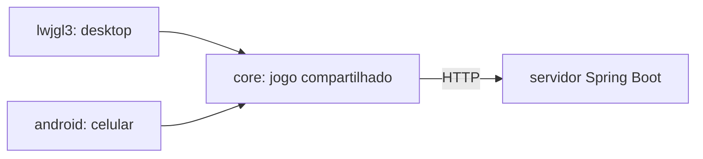

# Fase 06 - Tutorial: Android com libGDX

Este tutorial explica como o Missão Marte passou a rodar no celular e como o servidor foi preparado para ser publicado. Ele não usa o tutorial de API, Gradle e libGDX como base; as fontes oficiais estão na seção 12.

## 1. O que muda e o que não muda

O jogo (regras, telas, sons) continua um só: o módulo `core`. A Fase 6 acrescenta:

- o módulo `android`, que só sabe iniciar o jogo no celular;
- **controles por toque** (botões virtuais e toque nos menus);
- uma **tela de configuração do servidor** (endereço, porta, HTTPS);
- no servidor, o necessário para ser **publicado** (`/api/saude`, porta e endereço por variável de ambiente, `Dockerfile`).



A regra da arquitetura continua valendo: `domain`, `application` e `infrastructure` não importam `com.badlogic`. A decisão de "toque ou teclado" fica na camada `gdx` e nos *launchers*.

## 2. O módulo Android

Em libGDX, cada plataforma é um módulo pequeno que depende do `core`. O do Android tem o `AndroidLauncher`, um `Activity` que monta as dependências e chama `initialize(jogo, configuracao)`:

```java
MissaoMarteGame jogo = new MissaoMarteGame(
        new MissaoFactory(),
        new RankingService(new FileRankingRepository(new File(getFilesDir(), "ranking.json").toPath())),
        new ServidorHttp(endereco),
        endereco,
        new Plataforma(true, true),   // modo toque ligado, caixa de texto nativa disponível
        new Random());
initialize(jogo, configuracao);
```

Compare com o `Lwjgl3Launcher`: as mesmas peças, trocando o arquivo do ranking (pasta privada do app) e a `Plataforma`.

O `android/build.gradle` define `minSdk 26`, `compileSdk` e `targetSdk 35`, usa os assets de `core/assets` e empacota as bibliotecas nativas do libGDX. Elas vêm dentro de `.jar`; as tarefas `extrairNativas_<abi>` extraem os `.so` de cada arquitetura (ABI) para `build/nativas`, e o plugin do Android os coloca no APK.

> **Por que o módulo `android` pode sumir do build?** O `settings.gradle` só inclui `android` se encontrar o SDK (`local.properties` ou `ANDROID_HOME`). Assim o desktop não depende de ter o Android instalado.

## 3. Compatibilidade de código com Android

O Android 8.0 (API 26) não tem todas as APIs do Java 17. O código do `core` foi revisado e algumas chamadas trocadas:

| Antes | Depois |
| --- | --- |
| `Files.readString` e `Files.writeString` | `new String(Files.readAllBytes(...), UTF_8)` e `Files.write(...)` |
| `List.of(x)` | `Collections.singletonList(x)` |
| `String.isBlank()` | `trim().isEmpty()` |
| `"*".repeat(n)` | `Arrays.fill` em um `char[]` |

O compilador de Android (D8) converte *lambdas*, `switch` por texto e outros recursos da linguagem, mas **não cria APIs que o aparelho não tem**. A dica é procurar o que foi acrescentado ao Java depois do Java 8 e conferir a API mínima.

## 4. Entrada por toque

O libGDX entrega o dedo como um evento de mouse (`touchDown`, `touchUp`), no mesmo `InputProcessor` do teclado. Por isso o modo toque funciona também no desktop: o mouse faz o papel do dedo.

A `TelaBase` mantém uma lista `botoes` (`BotaoVirtual`: id, rótulo e retângulo), desenha os botões e entrega o toque:

```java
@Override
public boolean touchDown(int telaX, int telaY, int ponteiro, int botao) {
    if (!jogo.modoToque()) return false;
    BotaoVirtual b = botaoEm(telaX, telaY);      // converte tela em mundo (viewport.unproject)
    return b != null && aoTocar(b.getId(), ponteiro);
}
```

Cada tela decide o que cada botão faz. No menu, o toque na opção chama o mesmo método que a tecla. Na partida, `ControleDeToque` traduz o botão em `Acao`, e a sessão do jogo **não sabe** se a ação veio do teclado, do toque ou do controle:

```java
Acao acao = ControleDeToque.acaoDe(id);   // "cima" -> Acao.CIMA ...
executar(acao);
```

As setas repetem enquanto o dedo fica apoiado (o `ponteiro` identifica o dedo e `touchUp` para a repetição), como a tecla segurada no teclado.

## 5. Tamanho de tela: viewports

O jogo foi desenhado para 800x600. Celulares têm outras proporções:

- no desktop continua o `FitViewport`: mantém a proporção e põe faixas pretas;
- no modo toque usa-se o `ExtendViewport(800, 600)`: mantém a proporção e **estende o mundo** na dimensão que sobra. Num celular 20:9, o mundo fica com cerca de 1333x600.

Os botões virtuais ocupam os 260 pixels finais do mundo (`ControleDeToque.LARGURA_DA_AREA`), então acompanham a largura da tela. Telas fora da partida são centralizadas movendo a câmera para x = 400. Em telas 4:3 não há área extra e os botões ficam sobre o painel lateral.

## 6. Digitação no celular

Não há teclado físico. A `Plataforma` abre a caixa de texto do sistema:

```java
Gdx.input.getTextInput(listener, titulo, atual, "", OnscreenKeyboardType.Password);
```

A resposta chega fora da thread do jogo; por isso o texto passa por `Gdx.app.postRunnable` antes de alterar o formulário. A senha nunca é preenchida na caixa e usa o tipo `Password`. Os formulários (`FormularioDeLogin`, `FormularioDeServidor`) ganharam `definirTexto`, que aplica as mesmas regras de digitação a cada caractere.

A tecla **Voltar** do Android é capturada com `Gdx.input.setCatchKey(Keys.BACK, true)` e tratada como `Esc`.

## 7. Controle Bluetooth (opcional)

O Android entrega os botões de um controle como teclas. No libGDX o direcional já tem o mesmo código das setas (`DPAD_UP` é igual a `UP`, e assim por diante), então só foi preciso mapear `BUTTON_A` e `DPAD_CENTER` como embarcar e `BUTTON_B` como abortar em `TecladoParaAcao`. Há teste de unidade, mas **não foi verificado com um controle real**.

## 8. Configurar o servidor dentro do jogo

`ConfiguracaoDoServidor` é um objeto de valor imutável: valida endereço (IPv4 ou nome), porta (1 a 65535) e esquema ao ser criado. Texto como `http://x/a@b`, com espaços ou barras, é **recusado**, não interpretado.

- `RepositorioDeConfiguracaoDoServidor` salva em um `ArmazemDeTexto` (porta); no jogo, as `Preferences` do libGDX. Só endereço, porta e HTTPS são salvos.
- `EnderecoDoServidor` aplica a precedência: **salvo > padrão do lançador > `http://localhost:8080`**. O `ServidorHttp` lê a URL a cada chamada, então a troca vale na hora.
- A tela `ConfigServidorScreen` tem **Testar conexão** (chama `GET /api/saude` no endereço digitado, antes de salvar), **Salvar** e **Restaurar padrão**.
- Trocar de servidor **encerra a sessão**: o token só vale para o servidor que o emitiu.
- HTTP para fora da rede local mostra um aviso (`exigeAviso()`): senha e token iriam sem criptografia.

## 9. HTTP e HTTPS no Android

Desde o Android 9, o app não aceita HTTP sem criptografia por padrão. O projeto usa um *manifest placeholder* por tipo de build:

```groovy
debug   { manifestPlaceholders = [usaHttpSemCriptografia: 'true']  }
release { manifestPlaceholders = [usaHttpSemCriptografia: 'false'] }
```

e o manifesto usa `android:usesCleartextTraffic="${usaHttpSemCriptografia}"`. Assim o APK de teste conversa com o servidor local (HTTP), e um release só falaria HTTPS. Confira no APK com `aapt2 dump xmltree --file AndroidManifest.xml app.apk`.

O endereço padrão embutido vem de `-PservidorPadrao`, validado por expressão regular antes de virar `BuildConfig` (evita colocar texto qualquer no código gerado).

## 10. Preparar o servidor para publicar

Mudanças mínimas no servidor da Fase 5:

| Mudança | Para quê |
| --- | --- |
| `server.address=${SERVER_ADDRESS:127.0.0.1}` | Por padrão só a máquina local acessa; `0.0.0.0` libera outros aparelhos |
| `server.port=${PORT:8080}` | Provedores de nuvem informam a porta em `PORT` |
| `GET /api/saude` público | Botão Testar conexão e verificação de saúde |
| `server.forward-headers-strategy=framework`, `server.shutdown=graceful` | Funcionar atrás de proxy HTTPS e encerrar sem cortar requisições |
| `bootJar { archiveFileName = 'app.jar' }` | Nome fixo para o `Dockerfile` |
| `Dockerfile` e `.dockerignore` | Imagem em duas etapas, usuário sem privilégios, dados em `/dados` |

Spring Boot lê variáveis de ambiente por *relaxed binding*: na variável os pontos viram `_` e os hífens somem. Por exemplo, `springdoc.swagger-ui.enabled=false` vira `SPRINGDOC_SWAGGERUI_ENABLED=false` (testado).

O passo a passo (Wi-Fi local e nuvem) está em [servidor/DEPLOY.md](../servidor/DEPLOY.md).

## 11. Como testar

**Automático:** `gradlew test` no servidor (36) e no cliente (141). Os testes novos cobrem `ConfiguracaoDoServidor`, `EnderecoDoServidor` com armazém em memória, `ControleDeToque`, `FormularioDeServidor`, `FormularioDeLogin.definirTexto` e `TecladoParaAcao`.

**Desktop em modo toque** (simula o celular sem aparelho):

```powershell
.\gradlew.bat :lwjgl3:run -Dmissaomarte.toque=true --console=plain
```

**No celular**, depois de gerar o APK (README da fase):

1. Ative as opções de desenvolvedor e a depuração USB; conecte o cabo.
2. `adb devices` deve listar o aparelho; `adb install -r ...\android-debug.apk`.
3. Servidor: `adb reverse tcp:8080 tcp:8080` (celular enxerga o PC como `localhost:8080`), ou use Wi-Fi seguindo o `DEPLOY.md`.
4. No jogo: opção 6, **Testar conexão**, **Salvar**. Entre ou crie conta, jogue, abra o ranking global.
5. Confira: toque nas setas, Embarcar, Abortar, tecla Voltar, rotação, caixa de texto da senha, app em segundo plano e de volta.
6. Se algo falhar: `adb logcat -s MissaoMarte` (as telas registram o ciclo de vida no log com a etiqueta `MissaoMarte`).

## 12. Fontes oficiais

- libGDX: wiki (entrada, viewports, extensões e backend Android) e Javadoc de `Input.getTextInput`, em <https://libgdx.com/wiki/> e <https://libgdx.com/dev/>
- Android Gradle Plugin: tabela de compatibilidade com Gradle, JDK e API em <https://developer.android.com/build/releases/gradle-plugin>
- Android: configuração de segurança de rede e tráfego sem criptografia, em <https://developer.android.com/privacy-and-security/security-config>
- Android: `adb`, em <https://developer.android.com/tools/adb> (comando `reverse`)
- Spring Boot: configuração externa e variáveis de ambiente, em <https://docs.spring.io/spring-boot/reference/features/external-config.html>
- Docker: referência do Dockerfile, em <https://docs.docker.com/reference/dockerfile/>
- Provedores citados no `DEPLOY.md` como exemplo de limites de planos gratuitos: <https://render.com/docs/free>

As versões efetivamente usadas e as divergências em relação às mais novas estão no [planejamento](fase-06-planejamento.md).

## Exercícios sugeridos

1. Acrescente um botão "Pausar" ao `ControleDeToque` e trate-o em `GameScreen.aoTocar`. O que precisa mudar nos testes?
2. Faça a tela de configuração lembrar o último endereço **testado com sucesso** e mostrá-lo como dica.
3. Troque o `Dockerfile` para usar um usuário e uma pasta de dados diferentes e rode `docker build` (requer Docker em execução).
4. Gere o APK com `-PservidorPadrao=http://10.0.2.2:8080` e confirme o valor em `BuildConfig.java`.
5. Pesquise como assinar um APK de release e por que o build deste projeto produz apenas `android-release-unsigned.apk`.
