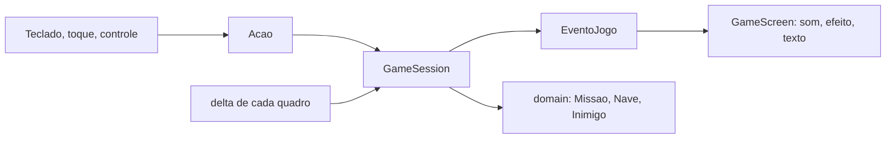

# Fase 07 - Tutorial: tempo real, novas armas e layout responsivo

Este tutorial mostra como o Missão Marte ganhou **tempo real**, **tiro**, um **inimigo perseguidor** e um **layout responsivo**, sem quebrar as camadas das fases anteriores. Ele serve de roteiro para você fazer as suas próprias melhorias (veja o enunciado). Como a Fase 7 não adota nenhuma tecnologia nova, as fontes oficiais usadas são as de libGDX e Android citadas na seção 12.

## 1. A regra de ouro: estender, não reescrever

Uma boa melhoria **acrescenta** código e muda pouco do existente. Antes de começar, pergunte:

1. Em qual camada ela mora? Regra do jogo é `domain` ou `application`; desenho e entrada são `gdx`; rede e arquivo são `infrastructure`.
2. Que ponto de extensão já existe? Aqui foram `Acao`, `EventoJogo`, `Perigo`/`Inimigo` e o `MapaGeometria`.
3. O que **não pode** mudar? O modo clássico, os testes antigos e o servidor.



## 2. Do jogo por turnos ao tempo real

No modo clássico tudo acontece dentro de `processarAcao`: uma tecla, um turno. Para o jogo correr sozinho, a tela repassa **o tempo** a cada quadro:

```java
// GameScreen (modo dinâmico)
ResultadoTurno resultado = session.avancar(delta);   // delta = segundos desde o quadro anterior
```

Dentro da sessão, o tempo vira **passos fixos**:

```java
public final class Temporizador {
    public int avancar(float delta) {          // quantos intervalos completos terminaram
        acumulado += delta;
        int passos = 0;
        while (acumulado + TOLERANCIA >= intervalo) { acumulado -= intervalo; passos++; }
        return passos;
    }
}
```

Por que passo fixo? Se o inimigo andasse "um pouco" a cada quadro, o jogo seria diferente em 30, 60 ou 144 quadros por segundo. Com o passo fixo, 1 passo a cada 0,9 s é 1 passo a cada 0,9 s em qualquer aparelho, e a regra continua em **células**.

Três cuidados:

- **Limite de `delta`:** `Math.min(delta, 0.1f)`. Se o aparelho engasgar por 2 s, o jogo não "pula" 2 s de uma vez.
- **O tempo é parâmetro.** Nada nas regras lê `System.currentTimeMillis()` (só o modo clássico, como antes). Por isso os testes usam tempo simulado e rodam em milissegundos:

```java
private static List<EventoJogo> passar(GameSession s, float segundos) {
    for (int i = 0; i < Math.round(segundos / 0.05f); i++) { s.avancar(0.05f); }
    ...
}
```

- **Ordem dentro do quadro:** nave, inimigos, perseguidores, pontuação. Depois de cada passo a colisão é verificada, então a nave e um inimigo que "trocam de célula" não passam um pelo outro sem se encontrar.

## 3. Entrada contínua: segurar a direção

O jogo por turnos reage ao *evento* "tecla apertada". O dinâmico precisa do *estado* "direção pressionada". A tela avisa a sessão quando a direção é pressionada ou solta:

```java
session.pressionar(Acao.DIREITA);   // keyDown ou toque no botão
session.soltar(Acao.DIREITA);       // keyUp ou o dedo sai
```

A sessão guarda as direções pressionadas (a **última** vale) e a nave anda uma célula a cada 0,15 s enquanto houver direção. Um detalhe aprendido nos testes: um toque mais curto que um quadro podia ser perdido (`keyDown` e `keyUp` no mesmo quadro). A sessão guarda um `passoPendente` para que todo toque valha ao menos um passo.

No toque, cada dedo (ponteiro) é lembrado: tirar o dedo da seta solta só aquela direção.

## 4. Strategy: um inimigo que persegue

O movimento do inimigo estava dentro de `Inimigo`. Para ter um segundo comportamento sem editar `Inimigo` toda vez, o movimento virou uma **estratégia**:

```java
public interface MovimentoDoInimigo {
    Posicao proxima(Posicao atual, Posicao alvo, int min, int max, Random random);
    char simbolo();
    boolean persegue();
}
```

`MovimentoAleatorio` faz os mesmos dois sorteios de antes (a ordem importa: as sementes de teste continuam valendo). `MovimentoPerseguidor` anda um passo no eixo de maior distância e **não usa sorteio**. `Inimigo(x, y)` continua usando o aleatório; `Inimigo(x, y, MovimentoPerseguidor.INSTANCIA)` persegue.

Aprendizado do desenho: o desenho do inimigo vem do `simbolo()` dele (`SimboloParaImagem`). O perseguidor usa `'C'`, porque o `'P'` já é o professor. **Antes de escolher um símbolo, procure se ele já existe.**

Já que perseguidor tem ritmo próprio (é mais lento que a nave, senão seria impossível fugir), a sessão tem um `Temporizador` para ele.

## 5. Um comando a mais: o tiro

`Acao.ATIRAR` entra no enum; teclado (`F`, `Espaço`), controle (`A`) e botão virtual só precisam traduzir para ela. `GameSession.atirar()` verifica as condições (modo dinâmico, sem pausa, com munição, arma recarregada), cobra os pontos e pede ao domínio:

```java
ResultadoDoTiro r = missao.disparar(nave.getPosicao(), dx, dy, min, max);   // primeiro perigo da linha
```

O domínio **decide**; a sessão **orquestra**; a tela **mostra**. Para a tela saber o que desenhar, a sessão emite eventos (`TIRO`, `PERIGO_DESTRUIDO`) e guarda o último `ResultadoDoTiro` (origem e destino do raio). Som, explosão e raio são reações da tela a esses eventos, como já eram com `COLISAO` e `ENTREGA`.

Para **não alterar o modo clássico**, `MissaoFactory` acrescenta a munição e os perseguidores *depois* dos sorteios existentes e só no modo dinâmico: a mesma semente gera o mesmo cenário de antes (há teste para isso).

## 6. Pausa e ciclo de vida

No tempo real, o jogo não pode continuar correndo com o aplicativo em segundo plano. `Screen.pause()` do libGDX é chamado nessa hora, então `GameScreen.pause()` pausa a sessão. A mesma pausa tem tecla (`P`), botão e a tecla Voltar do Android. A partida também começa com uma contagem de 3 s, para dar tempo de colocar o dedo nos botões.

## 7. Layout responsivo

O layout da Fase 6 era fixo. O de agora é **calculado** por `LayoutDaPartida`, uma classe sem libGDX que recebe o tamanho visível do mundo e devolve retângulos:

```java
LayoutDaPartida l = LayoutDaPartida.calcular(larguraDoMundo, alturaDoMundo, 11, modoToque, margens);
l.mapa();  l.painel();  l.controles();  l.celula();  l.origemX();
```

- **Paisagem** (largura ≥ altura): `[mapa] [painel] [controles]`. O mapa cresce até a altura; se a tela for estreita (4:3), encolhe para nada se sobrepor.
- **Retrato:** barra, mapa (usa a largura), faixa de informações e controles embaixo, onde o polegar alcança.
- O desktop sem toque, em 800x600, dá **os mesmos números da Fase 6** (origem 24 x 36, célula 48, painel em x=570). Há um teste exatamente para isso: refatorar sem mudar o comportamento.

Como o layout é um objeto de valor, ele é testado em 11 formatos de tela e 3 conjuntos de margens (nada fora do mundo, nada sobreposto). Isso é bem mais barato que abrir uma janela e olhar.

### Viewport

No modo toque a tela usa `ExtendViewport(800, 600)`: mantém a proporção e **estende o mundo** no eixo que sobra. Num celular em paisagem o mundo fica com cerca de 1333 x 600; em retrato, 800 x cerca de 1500. O layout usa **o mundo inteiro**, então a câmera da partida fica no centro dele. As demais telas continuam numa área de 800x600 centralizada.

### Medidas físicas

Uma tela de celular tem muito mais pixels por unidade do mundo e densidade própria. `EscalaDeTela` faz as contas:

```java
alvoMinimoNoMundo(densidade, pixelsPorUnidade) = 48 * densidade / pixelsPorUnidade   // 48 dp
fatorDeTexto(densidade, pixelsPorUnidade)       // texto nunca menor que 12 dp (entre 1 e 1,6)
```

Os botões nunca ficam menores que 48 dp (o tamanho mínimo recomendado para um alvo de toque) e o texto cresce nos celulares sem mudar nada no desktop. As margens de recortes e barras do sistema vêm de `Gdx.graphics.getSafeInset*()`.

Dois ajustes de usabilidade na base de telas: o botão com texto é ampliado até o alvo mínimo, e, se o toque cair em mais de um botão ampliado, vale o de **centro mais próximo** do dedo.

## 8. Orientação e manifesto

O manifesto passou de `sensorLandscape` para `fullSensor`: o aparelho gira livremente. Como `configChanges` já inclui `orientation|screenSize`, o Android **não recria** a atividade; o libGDX só chama `resize`, e a tela recalcula o layout no quadro seguinte.

## 9. Testando o que não se vê

| O que | Como |
| --- | --- |
| Passo fixo, tempo, pontuação por segundo, pausa, colisão, tiro, perseguidor | Testes de `GameSession` com tempo simulado |
| Movimento do perseguidor, tiro no domínio | Testes de domínio, sem libGDX |
| Layout, botões, escala | Testes de objetos de valor em vários tamanhos |
| Modo clássico igual ao anterior | Os 141 testes antigos e a partida da semente 4 |
| Aparência | Simulação no desktop: `-Dmissaomarte.toque=true -Dmissaomarte.janela=540x1200` |

Roteiro no desktop (simula o celular sem aparelho):

```powershell
.\gradlew.bat :lwjgl3:run -Dmissaomarte.toque=true -Dmissaomarte.janela=1200x540 --console=plain   # paisagem
.\gradlew.bat :lwjgl3:run -Dmissaomarte.toque=true -Dmissaomarte.janela=540x1000 --console=plain   # retrato
.\gradlew.bat :lwjgl3:run -Dmissaomarte.toque=true -Dmissaomarte.janela=1024x768 --console=plain   # 4:3
```

No celular, instale o APK como na Fase 6 e confira: segurar as setas, atirar, pausar, girar a tela, a tecla Voltar e a pausa ao trocar de aplicativo. **Nada disso foi verificado em aparelho** (veja o README da fase).

## 10. Como propor a sua melhoria

1. **Escreva em uma frase** o que muda para o jogador.
2. **Escolha a camada** e o ponto de extensão. Se precisa mexer em muitas classes existentes, repense.
3. **Escreva o teste antes** (ou junto). Tempo simulado e sementes fixas tornam tudo reproduzível.
4. **Preserve o modo clássico** ou diga explicitamente o que mudou e por quê.
5. **Não toque no servidor** sem necessidade; se tocar, atualize os testes dele.
6. **Documente** a decisão, os riscos e o que você **não** verificou.

Ideias: novas fases (campanha), chefões, outras armas, personalização da nave, velocidade crescente ao longo da partida. O enunciado traz as regras e os critérios de avaliação.

## 11. Melhorias sugeridas para esta base

- Extrair as regras comuns de `GameSession` (colisão, embarque, entrega, vitória) para uma classe compartilhada pelos dois modos (hoje a classe tem cerca de 450 linhas).
- Registrar o modo da partida no servidor, para separar os rankings (exige mudar a API, o banco e os testes do servidor).
- Adaptar também as telas de entrada, servidor, ranking e histórico ao retrato.
- Ajustar o balanceamento (velocidades, munição, recarga, custo do tiro) jogando no celular.

## 12. Fontes oficiais

- libGDX: wiki sobre viewports (`FitViewport`, `ExtendViewport`), entrada (`InputProcessor`), ciclo de vida (`ApplicationListener`: `pause` e `resume`) e Javadoc de `Graphics` (`getDensity`, `getSafeInset*`) em <https://libgdx.com/wiki/> e <https://libgdx.com/dev/>
- Android: orientação e mudanças de configuração, em <https://developer.android.com/guide/topics/resources/runtime-changes> e `android:screenOrientation` em <https://developer.android.com/guide/topics/manifest/activity-element>
- Android: tamanho mínimo recomendado de alvos de toque (48 dp), em <https://developer.android.com/guide/topics/ui/accessibility/principles>

As versões usadas e as divergências do plano estão no [planejamento](fase-07-planejamento.md). As páginas mudam com o tempo: confira se os endereços ainda existem e qual versão da documentação você está lendo.

## Exercícios sugeridos

1. Ajuste as velocidades de `RegrasDeTempoReal` e escreva um teste que mostre que o perseguidor **não** alcança a nave se ela andar sempre na direção oposta.
2. Acrescente munição ao entregar passageiros na base (qual classe muda? qual evento novo?).
3. Crie um segundo comportamento de inimigo (por exemplo, que anda em linha reta até bater na borda) como nova implementação de `MovimentoDoInimigo`.
4. Faça a tela de ranking se adaptar ao retrato usando a mesma ideia do `LayoutDaPartida`.
5. Escreva um teste do caso "nave e inimigo trocam de célula no mesmo passo" e diga se o jogo trata bem.
